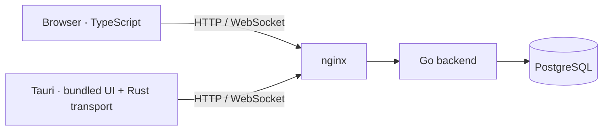

# Zchat

[](https://github.com/zever4/Zchat/actions/workflows/ci.yml)

A messenger with private and group conversations, live messages, file sharing and
voice messages. Built with Go, PostgreSQL and a browser client written in TypeScript.

Zchat is a portfolio project with a working local browser demo. A Windows Tauri
client shares the same interface; chat and call integration are checked locally.
Windows x64 installers are available as a preview in
[Releases](https://github.com/zever4/Zchat/releases).
The experimental Windows build supports end-to-end encrypted private chats with
text, photos, files and voice messages. Two local desktop clients were used to
verify delivery, reconnection and recovery. See [the demo](demo.md#experimental-e2ee).

## Features

- Private chats, groups, invitations and friend requests.
- Live delivery across browser tabs, reconnect, pending-message retries and paginated history.
- Images, files, voice messages, replies, message editing and deletion.
- Desktop photo uploads with an original/compressed choice, quality controls and preview.
- Profiles, avatars, privacy settings and group permissions.
- Persistent sessions, logout from one or all devices, and password changes.

See the [feature status](demo.md#current-feature-status) for call acceptance and
remaining limits. E2EE is experimental and disabled; ordinary chat works without it.

## Quick start

You need **Docker with Compose v2**, **GNU Make**, **Bash** and **OpenSSL**.
On Windows, run these commands in WSL with Docker Desktop's WSL integration enabled.
Go, Node and Rust are not required on the host for the browser demo.

```bash
git clone https://github.com/zever4/Zchat.git
cd Zchat
make init
make up
```

Open **[http://localhost:18080](http://localhost:18080)** and register an account.
Use a second browser profile or a private window to try a conversation between two accounts.

`make init` creates a private `.env` with separate random database and JWT secrets.
An existing `.env` is preserved. The first launch downloads images/dependencies,
builds the client and server, and applies database migrations automatically.

| Command | Purpose |
| --- | --- |
| `make` or `make help` | Show available commands |
| `make up` | Build and start the core stack in the background |
| `make run` | Start the stack and follow backend logs |
| `make logs` | Follow backend logs; Ctrl+C leaves the stack running |
| `make stop` | Stop the stack and keep its data |
| `make down` | Remove containers/network and keep data volumes |

Redis is optional. `make redis-up` starts its Pub/Sub service; `make redis-stop`
stops it. The experimental E2EE core can use it for wake-up hints; durable
delivery and recovery use PostgreSQL. See [development.md](development.md).

Ports bind to localhost. This setup is for a local demo; public hosting needs
HTTPS and the deployment work described in [development.md](development.md).

## Windows desktop preview

Download the `preview` x64 `.exe` from [Releases](https://github.com/zever4/Zchat/releases),
run the installer, and open **Zchat Desktop**. Installation is per user; WebView2
is downloaded if missing. The installer is currently unsigned.

Start the Go server separately with the quick-start commands above. The client
defaults to `http://127.0.0.1:18080`; use the title-bar gear to change its address.
The installer includes the desktop client only. For encrypted private chats,
use the `e2ee` x64 installer and follow the [experimental setup](demo.md#experimental-e2ee).
Install updates by downloading the new installer from Releases.
See the [changelog](CHANGELOG.md) for changes in each version.

## Architecture



The backend serves the client, exposes HTTP/gRPC APIs, authorizes chat operations
and delivers live messages through an in-memory WebSocket hub. PostgreSQL stores
users, chats, messages and sessions. Redis provides optional E2EE wake-up hints;
startup and health checks work without it. LiveKit carries optional call media.

## Documentation

- [High-level architecture](architecture.md)
- [Source builds, tests and Windows packaging](development.md)
- [Demo walkthrough and feature status](demo.md)
- [Monitoring dashboards and isolated load tests](monitoring.md)
- [Licensing and third-party notices](licensing.md)

GitHub Actions checks Go with PostgreSQL and the race detector, Go dependency
vulnerabilities, protocol generation, TypeScript, npm advisories, a full Docker
build and HTTP/WebSocket scenarios. See [the workflow](.github/workflows/ci.yml).

## License

Original Zchat code is licensed under **AGPL-3.0-only**. See [LICENSE](LICENSE)
and the [licensing notes](licensing.md). Dependencies retain their own licenses.
