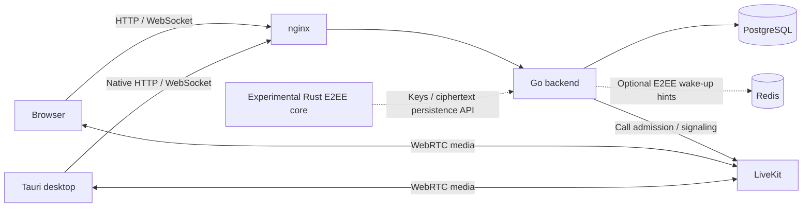

# Architecture

Zchat is a messenger with one Go backend, a browser client and a Windows Tauri
client sharing the same interface. The experimental Windows build also
provides a separate encrypted private chat.

## System overview

| Component | Responsibility | Source |
| --- | --- | --- |
| Shared frontend | Chats, history, attachments, profiles and calls | `web/` |
| Windows desktop | Bundled frontend, native network bridge, photo compression and OS integration | `src-tauri/`, `desktop/`, `rust-processor/` |
| Go backend | HTTP/gRPC APIs, authorization, chat rules and WebSocket fanout | `cmd/server/`, `internal/` |
| PostgreSQL | Users, sessions, chats, messages, attachment metadata and experimental E2EE public state/ciphertext inbox | `migrations/`, `internal/repository/` |
| LiveKit | Audio and screen-sharing media; Go controls admission | `internal/calls/`, `compose.calls.yaml` |
| Redis | Optional E2EE wake-up hints; bounded local notifications and PostgreSQL polling also work without it | `internal/redis/`, `internal/e2ee/wakeup/` |
| Monitoring | Prometheus metrics, Grafana dashboards and an isolated load lab | `monitoring/`, `scripts/load/` |

Ordinary uploads share a configurable disk budget across accounts, media and
avatars. Admission precedes multipart parsing; temporary files stay on the owned
upload filesystem. Open downloads retain their storage charge after unlink.
See [storage configuration](development.md#upload-storage). The private ciphertext
coordinator joins the same budget after filesystem/PostgreSQL reconciliation.
Private maintenance, upload and reservation/observation RPCs require explicit opt-in.
Maintenance keeps accounting/cleanup active when the experimental API is off.
The experimental desktop uses this runtime for encrypted attachments and
authenticated downloads.

## Message and session flow

A client authenticates against a persistent server session and opens a WebSocket
using a short-lived, single-use ticket. Go derives the sender and checks chat
permissions inside the database transaction that saves or edits the message.
Messages sent in anonymous mode retain their author mask in history.

After commit, the server acknowledges persistence and broadcasts to connected
members. The client keeps a pending queue across restarts and retries with the
same message UUID; PostgreSQL deduplicates those retries. This acknowledgement
means server storage, not recipient delivery or reading. History restores missed
live updates. Ordinary message content is readable by the backend.

Logout revokes the current login; logout-all and password changes revoke every
login. Active sockets are disconnected on revocation or expiry. Coordination and
fanout currently assume one Go process; horizontal scaling needs additional work.

## Desktop and calls

Tauri packages the shared UI and routes ordinary traffic through a native bridge
restricted to the selected server. Rust also prepares compressed photos before
uploading. Browser clients keep their ordinary upload path. Windows is the current
desktop target; Linux/macOS GUI acceptance is pending.

Calls use Go for session/member checks and signaling admission, and LiveKit for
WebRTC media. Media and server-control failures are separate: if LiveKit's
management API is unavailable, revocation blocks new admission, but disconnecting
existing media can wait for recovery. The Signal message-encryption work does not
implement call E2EE.

## Optional E2EE

The experimental Windows build supports separate encrypted chats between friends.
Rust owns private keys, Signal state and protected local history. Go owns
device/public-key registration, chat authorization and ciphertext persistence.
The client pins the peer's identity from the server directory on first contact.
There is one active cryptographic installation per account, with separate local
databases for different server/account pairs.

The experimental core covers protected Windows storage, authenticated account
and device registration, key publication, conversation creation and explicit
installation replacement. Protocol v2 text send/receive, persistence acknowledgements
and automatic Signal session confirmations commit their related protected state
atomically. Rust/Go/PostgreSQL tests exercise lost responses and local-store reopen
on Linux and Windows. Explicit native rejection retains protected ciphertext and
commits a rejection proof; ordinary processing failures do not reject messages.
An unused key acquisition can renew after an exact authenticated server expiry
response; retries reuse the committed successor without resetting Signal state.

Same-conversation recovery has an authenticated epoch-aware server API and signed
native observations. The local worker persists signed recovery requests and explicit
peer decisions with a send freeze before making RPCs; retries reuse the committed
bytes. A bounded audit resolves uncertain old sends before atomically activating
the next epoch. Old sessions and history remain available for delayed delivery;
only the accepted proposer bootstraps the new session. A serial native v2 driver
replays committed outbox/ACK work, polls old and current epochs, and continues saved
recovery commands without creating consent. It bounds RPC work, rotates lanes and
uses polling with optional hints. A native account runtime owns that driver and
the protected worker, alternates delivery with key maintenance, and accepts bounded
local requests while RPCs wait. Stopping it cancels networking and waits for store release;
different accounts keep separate stores. An opt-in Tauri session manager now binds
this runtime to the selected login, fences stale contexts, and waits for retirement
on navigation, logout, server changes and exit. Its IPC exposes redacted status and explicit initial key setup/retry. Ordinary
login only resumes saved state; a foreign installation cannot be replaced by setup.
Local tests with two Windows clients covered password-based installation
replacement, text and attachments, recovery and access to archived history.
Delivery statuses are persisted locally with the pending queue; server
storage and recipient storage remain distinct from reading. Some retained
runner/maintenance tests use an isolated prototype; its data API is not a
production fallback. The `experimental-e2ee` desktop build feature and server E2EE
flag stay off by default; ordinary chats work independently.
Host/PostgreSQL failures, GUI and WAN acceptance remain separate checks.

PostgreSQL holds accepted ciphertext. After commit, bounded local hints and optional
Redis Pub/Sub can wake an authenticated native inbox watcher. Hints carry no
ciphertext or acknowledgement; periodic polling recovers lost signals. Both native
futures stop together. Redis is an optional Compose profile and is not part of
readiness; `/health` checks PostgreSQL with a 2s budget. The desktop manager currently
polls for messages and delivery status.

One bounded background worker removes expired ciphertext and copies addressed to
replaced recipient installations, even while the experimental API is disabled.
It preserves persistence receipts and delivery facts; a late recipient ACK can still
refine an expired status. Local private-key retention and receipt GC remain pending.

Encrypted attachment preparation now commits ciphertext chunks and a protected
journal together in each account's local SQLite. Native transfers, message linking
and verified incoming cache are integrated with the account lifecycle. Durable file
ACKs use the authenticated native/server transport and the account's shared serial
metadata scheduler, with durable retry and local receipt observations. Sender file
metadata snapshots use protected status storage and independent authenticated polling.
One server cleanup loop reclaims accepted files after file ACK or the fixed retention
deadline, using an indexed active-copy queue; immutable delivery facts remain.
Native read-only archive access opens verified saved files from incoming cache or
promoted outgoing spools in the account's retained generations. Explicit native
removal of confirmed incoming and terminal outgoing copies preserves history and
delivery facts, while preventing stale plans from recreating deleted copies.
Native photo preparation produces a metadata-cleaned pixel copy or an explicitly
confirmed original before attachment encryption. The account owner runs codecs in
a bounded blocking lane, then rechecks the account instance and cryptographic epoch
before atomic preparation. A bounded binary IPC and desktop SDK expose new photo
input and read-only outcome lookup by UUID. Retries reuse retained ciphertext.
The chat lists prepared attachments from the local journal after restart.
Current and archived history show the saved attachment name, kind, size and
caption. The renderer gets presentation metadata while the native account keeps
file keys and encrypted storage. Binding, retention and storage rules are specified in
[the attachment contract](proto/attachments.md).

## Operating boundary

The default Compose stack exposes localhost ports. LiveKit and monitoring are
optional additions. Public hosting needs HTTPS, reachable media networking,
storage quotas/cleanup, backups and deployment acceptance. Local checks establish
specific behavior, not a production capacity or security guarantee.

See [README](README.md) for launch instructions, [development](development.md) for
builds/checks, [demo](demo.md) for feature status and [monitoring](monitoring.md)
for dashboards and load testing.
