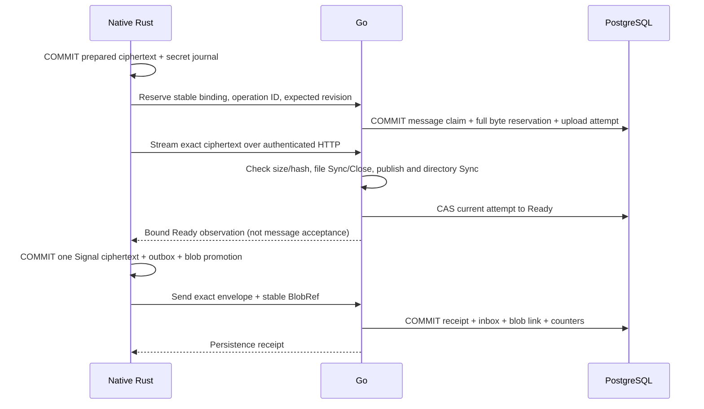

# Encrypted attachment transport: implementation contract

Status: BlobRef/framing/private-binding/receipt/fence contracts are implemented
and tested independently in Go/Rust. Native durable preparation exists. PostgreSQL
UUID claims, byte/count reservations and lease renewal CAS are implemented.
An isolated Linux filesystem writer/remover is also implemented;
short PG writer/Ready transactions and an authenticated upload coordinator
are implemented. Root binding, staged cleanup/reclaim, bounded startup reconciliation
and an explicitly started runtime collector are implemented. Ordinary shared-budget
admission and the private ciphertext accounting adapter are implemented. A tested
raw HTTP upload handler, owned runtime and authenticated gRPC reservation/observation
are available through explicit opt-in. A native reserve/observe client and durable
operation journal and a scoped native HTTP ciphertext transport are implemented.
Account-owned upload scheduling and atomic Go receipt/link/readers are implemented.
Protected native Signal promotion and retained-outbox readers are implemented.
Account-owned Ready promotion and existing-outbox Send retries are implemented.
Bound staging-error observations and retained native retry APIs are implemented.
Account-owned retained HTTP retry and real Go/Rust upload/Send/recovery acceptance
are implemented. Accepted download identity resolution and bounded filesystem
read leases and an owned authenticated streaming coordinator are implemented.
Authenticated full HTTP GET/HEAD are implemented through the same opt-in runtime.
Native GET/HEAD streaming and public metadata encoding are implemented as a scoped
transport foundation. Protected incoming-history plans, explicit native GET-to-cache
and verified ciphertext SQLite cache are implemented. Account-owned explicit download
scheduling and native local cache opening are implemented. Public FILEACK shapes,
immutable PostgreSQL ACK facts and repository validation are implemented as a
foundation. Native durable pending-ACK proof, bounded candidate paging, protected
receipt acceptance and authenticated native/server FILEACK RPC are implemented.
Automatic account-owner FILEACK dispatch and local receipt observations are implemented.
Sender file metadata snapshots have Go/Rust wire validation, a repository and
authenticated native/server RPC, protected monotonic persistence and independent
account-owner polling. Read-only opening of saved incoming and promoted outgoing files is
implemented in the native core. Explicit removal of confirmed incoming cache and
terminal outgoing spools is implemented natively. Forced pending/prepromotion
cleanup and file download and removal controls remain pending.
Native private-photo preprocessing, account-owned input admission, atomic
preparation and binary photo IPC/SDK are implemented. The active chat shows
prepared attachments, and current and archived history show attachment metadata.
The desktop photo dialog submits the chosen policy and a fresh message UUID.
Only cleanup settings can be remembered. Original files require explicit consent
to share source metadata. A retry checks the original UUID before submitting the
same input. A confirmed preparation may continue through the native queue while
the renderer displays another chat.
Accepted-deletion SQL admission, owned reader cancellation/join, proof-gated
physical/logical reclamation and startup resume are implemented. Indexed active-copy
discovery and automatic collector dispatch are implemented in the opt-in runtime.
Go service/RPC admits3 only through the owned blob runtime, when both existing
experimental flags expose it. Default flags and readiness/capabilities are unchanged.
Scope: one attachment per desktop E2EE message, one installation per account.

## Native private-photo preprocessing

`compression::prepare_photo` produces an opaque native `PreparedPhoto`, without
keys, file paths, transport, serde or a caller-set metadata-removal flag.

| Choice | Output | Source metadata |
| --- | --- | --- |
| Default `Clean`, no quality | Fresh PNG from oriented decoded pixels | Removed; no source ancillary chunks copied |
| `Clean`, selected quality | Fresh JPEG, or WebP for alpha; optional bounded resize | Removed, even if the result is larger than the input |
| Explicit `Original`, warning acknowledged | Exact source bytes | Preserved; never labelled stripped |

Quality and resize options are checked before decoding. The source format is
detected from bytes; supported static JPEG/PNG/WebP/BMP/single-page TIFF inputs use
the existing image/mozjpeg/WebP codecs and dimension/allocation limits. All eight
EXIF orientations are applied before fresh encoding. PNG preserves decoded alpha
and supported 16-bit channels. Source EXIF/GPS, XMP, comments, text, ICC and trailing
data are not copied. ICC-to-sRGB colour management is not implemented: preservation
of decoded pixel samples is not a promise of identical colour-managed appearance.

GIF (including single-frame GIF), APNG, animated WebP and multipage TIFF reject
`Clean`; this stage does not flatten them or silently pass through original bytes.
They can use explicit `Original` with retained-metadata acknowledgement. Original
mode probes the image header and dimensions; it does not validate/decode every frame.
Unsupported lossless pixel types, corrupt input, encoding errors and oversized
outputs return errors, never an original fallback. Normal optional compression
retains its older `keep_smaller`/animation behaviour and is not a privacy API.

The existing 20 MB source, 24 MP, 12000-pixel side and decoded allocation checks
apply. Clean PNG writes have an explicit output cap; lossy output is checked after
the existing bounded-pixel codec returns. These are data/decoder limits, not a hard
process RSS bound. This synchronous helper creates no threads. The account-owned
path below additionally retains file-memory/CPU admission through blocking work,
account cancellation and handing the result to immutable preparation.

With both compression and E2EE enabled, `photo_preparation::prepare_photo_attachment`
validates private metadata, normalizes the extension to the actual format and
returns a once-consumable native draft plus zeroizing plaintext. Clean results over
the 10 MB inline limit fail and require compression/resizing. An explicitly chosen
original BMP/TIFF or original over that limit uses the unchanged-byte `File` kind
with no photo flag; eligible inline originals use `Photo` with the flag false.
The lower-level attachment validator remains structural. An incoming photo flag is
an authenticated sender claim, not remote attestation of their preprocessing.

Preparation happens before the file key, blob UUID, plaintext-source digest, file
encryption and Signal promotion. Existing retained outbox retries consume their
saved ciphertext and must never re-run a codec. The native Signal/cache tests prove
this composition for clean and explicit-original photo inputs. Old ordinary-image preferences cannot silently imply
consent to retaining metadata in the new private-photo flow.

`AccountClient::prepare_photo` accepts a native `PhotoSource` (owned zeroizing bytes,
name, caption and choice), never a renderer path, key, MIME or metadata-stripped flag.
One process-wide E2EE input slot is acquired before queueing. A separate account
future runs one blocking codec without stalling its metadata/control lane. A one-shot
ticket holds the SAME account file-memory permit from preflight through atomic
preparation; it contains public binding data and a runtime-instance nonce, no worker
sender or database/key lease. An abandoned codec waiter retains admission until the
codec actually exits. Account shutdown can release/reopen its database meanwhile.
This gate covers the new E2EE path; ordinary desktop compression has a separate gate.
Input objects already allocated by native callers are not a hard process-memory cap.

Preflight rejects occupied outgoing UUIDs BEFORE any codec. Completion rechecks
instance, account/server/device, UUID uniqueness and the original epoch's current
closure/freeze in the preparation transaction. A late result never targets a new
epoch automatically. New input under ANY occupied UUID conflicts, even if the source
looks identical. Resolve unpromoted input using `prepared_attachment`, promoted
messages using `outgoing`, and use the existing retained ciphertext retry loop.
No recipe/source hash migration or schema change is needed for this new-input-only
contract. A cancelled request can race a started COMMIT: resolve its original UUID
before offering new input. `CatalogRequired` has no allocation/codec effect and
grants no catalogue/bootstrap authority. `Prepared` means local durable preparation;
the existing owned uploader then observes READY, promotes through Signal and sends.
The desktop IPC fences the renderer page/server/session context before dispatch
and before reply, with the existing request budget, reply lease and bounded wait.
Native `PhotoAdmission` is obtained before copying a binary source; it binds client,
chat/UUID and exact byte count and transfers the same E2EE job slot into preparation.
This bounds owned copies/jobs, not WebView/Tauri's pre-handler allocations.
No server readiness/capability flag changes; the Tauri main-window allowlist adds
only the two commands below. Default builds still have no active E2EE backend.

`e2ee_prepare_attachment` accepts a raw binary frame with a 4-byte little-endian
JSON length (1..16384), UTF-8 metadata and the source bytes. Strict metadata fields
are `epoch`, `context`, `requestId`, `conversationId`, `messageId`, `filename`,
`caption`, `choice`. Clean choice has `mode`, nullable `quality`, `maxDimension`;
Original has `mode` and explicit `metadataWarningAcknowledged:true`. Photo
source is capped at 20 MB. File choice has `mode:"file"` and a canonical decimal
`expectedEpoch`. It accepts a nonempty source up to 50 MB. The same native input
lane and memory permit prepare the original bytes as `application/octet-stream`.
Voice choice uses `mode:"voice"` and `expectedEpoch`, with a 10 MB source cap.
The worker identifies the Opus headers and derives `audio/ogg` or `audio/webm`
and the corresponding filename from the bytes. The worker checks the requested
epoch at admission and checks the resulting scope at commit. No account,
endpoint, path, key, descriptor, MIME or asserted stripped flag is accepted.
The known UUID is resolved before a source copy; a missing initial catalogue uses
the existing serial lookup/initial RPC, without acquisition/reset/recovery consent.
The worker still checks the bound epoch and vacancy after codec work.

`e2ee_attachment_input` reads one conversation/message UUID. Its protected transaction
returns `vacant`, `prepared` plus decimal `cryptoEpoch`, or `outgoing` plus epoch,
`storedOnServer` and `sealedUnsent`. The reply echoes only the two IDs and state,
wrapped in native context/reply lease. Wrong chat/kind, partial ciphertext and orphan
artifacts fail closed; terminal outgoing removal preserves outcome lookup. Vacant
is a read snapshot, never permission to reset a ratchet or overwrite a UUID.
SDK methods require an observed context, snapshot input options, check a retained
UUID before reading the file and fence token/context again after reads and reply ACK.
The UI can resolve a timeout by reading the original message UUID.

Listening opens only an explicitly selected verified local voice copy. It
rechecks the audio format and returns the existing context and reply lease in a
bounded JSON header followed by raw audio. The player releases its local blob
URL and audio source on view or session retirement. The MediaRecorder and
container references describe the input header formats. [MediaRecorder](https://www.w3.org/TR/mediastream-recording/) · [WebM](https://www.webmproject.org/docs/container/) · [Ogg Opus](https://www.rfc-editor.org/rfc/rfc7845.html)

The `e2ee_read` request `pending_attachments` pages the current installation's
prepromotion records for the selected conversation. The worker reads the bounded
manifest and authenticated preparation journals in a read transaction. Manifest
identity and size must match the journal. Ciphertext verification stays part of
upload and exact-UUID recovery. A page includes at most eight rows and follows
the same 16 KiB IPC reply budget as history. Opaque cursors bind the account,
worker lifetime, conversation and query type. A refresh begins a new traversal,
including messages added behind a cursor during pagination.

Pending rows carry the message UUID, epoch, timestamp and attachment metadata.
Promoted attachments appear in current and archive history with the same
metadata: kind, name, caption, MIME type, size and any sender claim about stripped
photo metadata. Replies expose these presentation fields and existing message
delivery status. File descriptors, blob identities and file keys stay native.

## Data binding and versions

A server-visible `BlobRef` contains only format version1, canonical UUIDv4 blob ID,
exact ciphertext byte count (37..52428836) and SHA256 of those bytes (32 bytes).
It contains no key, filename, MIME, caption, path, URL or upload credential.
This exposes attachment presence/size and routing, not its private description.
There is no content deduplication across messages, accounts, epochs or generations.

The optional `Envelope.blob` field uses tag10. Attachment envelopes require
**outer version3 with exactly one reference**; text and session-confirmation envelopes
retain outer version2 with no reference. A v3 envelope without a reference, or v2
with a reference, is invalid. Existing v2 frames and hashes stay byte-identical.
Do not silently add reference semantics to v2: older prost readers discard unknown
fields. The private payload remains attachment format3/nested format1; after Signal
authentication, native compares its blob ID, descriptor length/hash and all routing
fields to the outer reference BEFORE committing receive state/message ACK.

Epoch API contexts, acquisitions, catalogues and signed recovery controls remain
version2. Envelope framing version is a separate layer. `EpochSendBinding` must
carry the actual envelope version2/3 and its digest; recovery signatures/frames
remain unchanged. Old outer-v2 attachments are rejected. The old private-payload
fixture is retained byte-for-byte and tests construct its matching public ref.

Attachment envelope digest is SHA256 of this canonical frame, not protobuf bytes:

| Field, in order | Encoding |
| --- | --- |
| Domain | ASCII `zchat.e2ee.envelope.v3` and one NUL |
| Envelope version, crypto suite | u32 BE=3, u32 BE=1 |
| Message UUID, conversation UUID | 36 ASCII bytes each, canonical lowercase UUIDv4 |
| Crypto epoch | u64 BE, required presence, 0..INT64_MAX |
| Sender, then recipient | Each: account UUID36, device ID u32 BE=1, generation UUID36 |
| Signal ciphertext type | u32 BE; existing PreKeySignal/Signal enum |
| Blob ref version, blob UUID | u32 BE=1, UUID36 |
| Blob ciphertext count, SHA256 | u64 BE; 32 bytes |
| Signal ciphertext length, bytes | u32 BE; exact bytes |

The [public contract vector](fixtures/attachment-envelope-v3/design-vector.json)
provides field values and the expected354-byte frame checked by independent readers;
it is not a protobuf message or usable Signal/file ciphertext.

Lease time, upload attempt/revision, network outcome and storage path are excluded.
All stable public fields are covered; receive, receipt, status, ACK, recovery fence
and outgoing audit must use the same version-specific digest. Unsupported versions
fail closed. Capabilities must advertise supported framing/attachment format and
availability explicitly; both readiness flags remain false until acceptance.

This requires a coordinated development cutover of server and desktop builds; it
adds no recipient-version negotiation. An older desktop rejects3 and can stall its
pending inbox. Mixed-version availability needs a separate capability negotiation
contract before supporting such deployments. Signal sessions/epochs are shared by
text2 and attachment3; a framing upgrade never creates a new ratchet or device.

## Native reservation and observation API

The experimental v2 `Messenger` exposes `ReserveBlob` and `ObserveBlob` using the
same `BlobLeaseRequest`. Context remains2 and must name the authenticated current
installation. Both calls require the account JWT and device credential through
the existing native gRPC interceptor. They carry only the public route, BlobRef,
message/operation UUIDs and expected revision/attempt. File keys, private
descriptors, Signal state and file contents never belong in these calls.

`ReserveBlob` commits a first reservation or an explicit new-operation renewal.
Replaying the current operation preserves its original attempt/revision/deadline.
`ObserveBlob` reads the **exact original operation**, including a superseded one;
it never allocates a claim, changes the current head, renews TTL or charges quota.
The original expected revision/attempt must still match. An old operation's
observation does not select the current head or grant permission to upload it.

`BlobLease` binds message, operation, attempt, revision, immutable one-hour deadline,
observed DB time, state and expiry. Revision equals the original expected revision+1.
The native caller must validate the entire response before persisting it. States
Reserved/Writing/Ready/Deleting/Reclaimed/Linked are metadata observations;
**even Ready or Linked is not a Send receipt**, crypto promotion or file ACK.

Failures have method-specific `BlobFailure` details bound to the exact request:

| Reason | gRPC code | Meaning |
| --- | --- | --- |
| OPERATION_NOT_OBSERVED | NotFound | Observe only, after authorized read COMMIT |
| CAS_CHANGED | Aborted | Current reservation head or operation changed |
| ACTIVE_LEASE | FailedPrecondition | Current lease cannot yet be renewed |
| BINDING_CONFLICT | AlreadyExists | Immutable route/ref/CAS replay differs |
| CAPACITY | ResourceExhausted | Reservation byte/count limit reached |
| STORAGE_UNAVAILABLE | FailedPrecondition | Blob API is disabled/not ready |

Generic transport, transaction COMMIT, cancellation, session and epoch errors
must not be interpreted as absence. Even committed absence is only a point-in-time
observation of this operation: another concurrent Reserve may commit later. It
does not prove a message unsent, globally unused operation ID or quota availability.
Retry the **same** operation; never create another message UUID/key/session from it.

Native preparation journal format2 requires the initial operation in the SAME
protected transaction as ciphertext chunks. A missing operation is corruption,
never a reason to mint a new one during lookup. Local plan creation rechecks the
account/origin/generation, current catalogue/freeze/closure, private payload binding
and all chunk hashes. The opaque plan exposes only its public request; no file key,
private descriptor or source fingerprint is available to the wire caller.

The native client uses the existing authenticated v2 channel and bounded deadlines.
Successful leases and typed failures are separate opaque observations. Only a valid
lease can enter the account worker's acceptance API; a missing/conflicting request
cannot renew local state. Applying a lease rechecks the current immutable cohort,
operation and lifecycle, preserves its original attempt/deadline, ignores older
observations and rejects contradictory forward-time regressions. Linked is sticky
and never grants renewal, even after a later deletion/reclaim observation.

Renewal requires a durable eligible DB observation, not the client's clock or a
generic network failure. One protected transaction stores the new operation and
expected revision/attempt CAS, preserving message UUID, private payload, file key
and ciphertext. Retain the immediate predecessor for exact repeated renewal; older
plans cannot skip another successor. This bounds local control history. Server
attempt metadata remains retained separately. The previous isolated preparation
journal format1 is rejected without automatic conversion, resealing or key deletion;
there are no deployed attachment users requiring a compatibility reader.

The native account runtime schedules these APIs for durable preparations. The
experimental desktop connects photo preparation and explicit recipient download.
A plan is a checked snapshot, not permanent network permission. The upload-source
factory rechecks the current root, freeze/closure, immutable cohort, saved Reserved
lease and all chunks in one protected transaction. Its opaque result binds the
exact request/grant/ciphertext and carries the shared one-file permit. A Ready or
Linked observation cannot mint a new upload source.

The native HTTP transport accepts only this source and trusted native origin/CA
configuration matching the authenticated account scope. It sends the canonical
metadata header, exact Content-Length and unchanged ciphertext. HTTPS verifies
the server chain and hostname; HTTP is restricted to loopback development origins.
There are no redirects, ambient proxy settings, cookies, automatic retries or
response decompression. Connect is bounded to 5s, the whole exchange to 35s, response
data to 4096 bytes and response headers to 8192 bytes/32 entries.

Each transfer owns its HTTP connection inside its future; no detached connection
task retains the body after cancellation. Zero-copy 256KiB chunks keep the source
and its file permit alive until the last queued chunk drops. Cancel+close joins
that release before an owner may unlock its account. Explicit logout/switch/stop
invoke this API through owner cleanup; minimizing does not stop the owner.
Cancellation never deletes the prepared operation, file key or ciphertext and
cannot recall bytes already accepted by Go. Even 201 is only a transport result:
the caller must Observe the exact operation before deciding its next step. A lost
reply or 503 can follow a committed Ready state. No HTTP result promotes Signal
state or authorizes Send, a new message UUID, key or replacement session.

The native `upload_epoch_blob` step now composes these boundaries. It observes the
saved operation first; only a validated OPERATION_NOT_OBSERVED response allows
Reserve of that SAME operation. It accepts the lease in a protected transaction
and decides from the saved merged state, which can be newer than the remote reply.
It applies only before Signal/outbox promotion; an existing outgoing link is
rejected by the protected reader. Retained outbox retries need the receipt-first
path below, including when the staging file is missing or expired.
Writing/Ready/Linked do not start another PUT. An eligible expiry/reclaim commits
one CAS successor locally and returns; reserving it belongs to the next step.
A sticky prior Linked observation forbids renewal even after deletion/reclaim.

A step makes at most three metadata RPCs and one PUT, without loops or spawned
tasks. All queued file owners must join before post-PUT Observe/local acceptance.
HTTP success without an authoritative Ready observation does not mean ready.
An unknown result keeps the same intent and bytes. Account stop cancels and joins;
an explicitly cancelled PUT does not issue a follow-up RPC with old authentication.
The production adapter exclusively borrows matching RPC/HTTP transports, including
their origin/account/generation/JWT/device credential. The account runtime uses
the same validation through its serial metadata queue. Attachment IPC/UI remain pending.

## Account runtime ownership

TrustedServer preserves the native HTTP origin/HTTPS CA through authenticated
discovery and the ready-client handoff. The account constructs HTTP from that
opaque endpoint and its existing authenticated client, without renderer endpoints,
port guessing or authentication recovery. The configured CA extends trust for
both E2EE RPC and encrypted-file HTTPS; local HTTP uses no CA.

One account task polls local commands, a serial RPC loop and one HTTP upload
future. Blob Observe/Reserve requests use an internal queue of capacity1 handled
by that SAME RPC loop. Text, delivery, maintenance and blob metadata get bounded
turns; HTTP waiting does not borrow the RPC client. There is no cloned RPC lane
or spawned task per file. Each dispatched metadata RPC is bounded to10s; a
Ready-to-promotion/bootstrap command has a15s dispatch budget, matching foreground
network commands. Time spent in the bounded queue is not a remote RPC deadline.

Selection reads at most65manifest rows across all generations before filtering
the current one; more than64 is corruption, not permission to scan further.
Manifest IDs are hints only, existing outgoing links are skipped, and the upload
step still validates protected bindings/chunks before network. Per-file rotation,
jitter and backoff retain at most64entries; one transient failure does not block
other files. Ready observations poll more slowly. Volatile health/counters are
not message receipts; Linked is distinct from a live Ready file.

Stop/logout/switch, dropped owner or fatal authentication cancels borrowing futures
and joins the last HTTP source/chunk before dropping transport and shutting down
the worker/store. A dropped shutdown waiter cannot skip this independent cleanup;
while join is pending, account ownership remains locked. Preparation UUIDs, keys
and bytes survive.

A verified, durable, unlinked Ready observation is handed through the same bounded
RPC queue to the crypto worker. The handoff pins account/store, immutable preparation
and the exact current lease operation before creating a new outbox. An existing
committed outbox wins over changed lease availability. The last HTTP body/source
is joined before this handoff, releasing the shared file permit.

If a session is missing, only this saved user preparation can trigger bootstrap.
The command refreshes the authenticated conversation and checks the same epoch and
both device routes. It reuses the durable acquisition; renewal needs a bound server
expiry proof, at most two acquisition attempts per dispatch. A higher epoch may
bootstrap only on the agreed proposer's side. No initial catalogue is invented and
no recovery consent, key reset or automatic unfreeze is introduced.

After promotion the command wakes the existing delivery runner; it does not send
inside the HTTP loop. Existing promoted UUIDs are skipped by upload selection and
retried through the ordinary persisted outbox FIRST, without reading file chunks or
checking staging leases. Unknown outcomes retain the same UUID/Signal envelope.
Stop or a local timeout may leave a worker COMMIT pending; the next persisted read,
not volatile command health, resolves that outcome. Blob Ready, local Queued and
server receipt remain separate facts. The local promotion counter counts successful
handoffs, not unique messages or receiver file ACKs.

## Protected promotion and retained outbox

`promote_epoch_attachment(message)` runs on the existing per-account worker. It
first resolves an already committed promotion, otherwise reloads the current
root/freeze/closure/epoch/route, a durable Ready observation and exact local chunks.
If Signal bootstrap is required it reports that without local acceptance or reset.
Signal ratchet, history, outbox, projections, chain and promotion metadata commit
in ONE protected SQLite transaction. No prepared journal/chunks are deleted and
no result escapes before COMMIT. The generic encryption path still refuses a
reserved attachment UUID; its prepared-specific entry verifies the cohort itself.

The private preparation journal pins the outgoing envelope digest. The protected
UUID link pins the preparation payload/source cohort in the opposite direction.
All outgoing/history/status/fence readers validate both sides. These are local
protected metadata extensions, not network protocol fields or a database/key reset.

`epoch_attachment_outgoing(message)` returns only the exact persisted Send plan.
It does not require the file-buffer permit or read chunks, and remains usable
after freeze/seal or local file loss. Repeating promotion returns that same plan,
never another Signal encryption. It does not grant upload/renew authority.
Ready is a saved server observation, not permanent acceptance; actual Send must
still resolve a receipt/fence or arrange the exact-file retry. The account scheduler
now promotes and delegates exact Send to the existing outbox runner. Safe bound
missing-staging/expiry Send3 errors and retained upload controls are implemented
below. Account HTTP orchestration and real Go/Rust upload/Send/recovery acceptance
are checked; RPC Send3 requires the explicitly exposed owned runtime. Capabilities stay off.

## Exact Send failure and retained file retry

`BlobSendFailure` has only `NOT_READY` or `LEASE_EXPIRED` and a compact
`EpochSendBinding`. The binding is framing3 and pins both routes, epoch, message,
conversation and canonical digest of the entire envelope, including BlobRef and
Signal bytes. Ciphertext, filename, key, lease attempt and server diagnostics are
not echoed. The gRPC code must be FailedPrecondition, with exactly one matching
status detail and bounded bytes. Invalid/wrong-request/text2/generic/timeout/auth/
commit failures cannot create this observation; another RPC never carries it.

The repository wraps only the actual authorized Send Ready/link-gate failures.
Existing receipt and signed sealed fence still precede these gates. This error is
a point-in-time observation, not an unsent proof, message settlement or permission
to renew: another concurrent or lost Send may commit. A failed COMMIT stays generic.
The native delivery report retains bounded exact observations (at most the64-RPC
round budget); neither a timeout nor report eviction establishes nonacceptance.

`epoch_attachment_retry(observation)` is a separate protected worker entry for
promoted preparations, returning an opaque `EpochAttachmentRetryPlan`. Each native
accept-lease/renew/upload operation reloads the exact pending saved outbox, verifies
both promotion/cohort pins, current root/freeze/closure/epoch/device routes and all
ciphertext chunks. A received receipt or signed unsent fence blocks NEW file work;
old outbox settlement remains independent of file availability. Plans and observations
are native types, not renderer constructors, booleans or standing permissions.

The existing strict `current_journal` is unchanged. Preparation-only APIs still
reject every promoted UUID. Both routes share private lease merge/CAS/source helpers,
so observation monotonicity, linked-state latch and file-buffer ownership stay equal.
`renew_epoch_attachment_retry` still requires the saved exact DB lease observation
showing eligible expiry/reclaim; even LEASE_EXPIRED Send alone cannot authorize it.
The successor operation is saved atomically and CAS replay returns the SAME one.
`epoch_attachment_retry_upload` requires the current unexpired Reserved grant and
retains the shared file permit until the last encrypted body/source drops. UUID,
BlobRef, file key, chunks, Signal bytes/history/ratchet/cohort pins remain unchanged.

After restart the runtime must Send FIRST, then use a new bound failure, observe
metadata and upload/renew only if still eligible. The account now orchestrates these
retained APIs through its existing task, serial RPC lane and one HTTP future.
RPC3 admission requires the explicitly exposed owned runtime; default flags and
capabilities stay OFF pending remaining local-file management, photo preparation and IPC/UI acceptance.

The delivery runner hands exact failures to a bounded64notice channel without waiting
for HTTP. A full channel loses a scheduling hint only; later Send rediscovers it.
A native manifest query returns at most64current-generation file IDs, enforcing the
existing global65row overflow check before generation filtering. This query takes no
file permit and grants no transfer authority. Prepared selection remains separate and
still excludes outgoing markers. Per-file pending hints/backoff/watermarks are bounded
by that manifest; IDs appearing between its two snapshots wait for the next pass.

A notice records host-monotonic Send START time. Each completed retained step sets a
per-file watermark; older queued hints, including delayed replies to earlier Sends,
cannot start another step. The timestamp only orders work, never decides lease expiry.
New hints do not reset backoff. Files rotate across one prepared/retained schedule;
waiting files without hints do not cause a busy loop or block text/delivery/maintenance.

Each retained step performs at most4metadata RPCs, one eligible local renewal and one
PUT. It observes the saved operation, replays absence with that SAME request, renews
only from durable eligible DB proof, then reserves/streams/joins/reobserves the exact
ciphertext. It never calls Signal promotion or bootstrap. A separate RetainedControl
command uses the same capacity1RPC queue and10s dispatch budget; worker refresh rechecks
pending outbox/current lifecycle/cohort/current operation/chunks at actual dispatch,
then acceptance and source creation recheck again. Ordinary control APIs stay strict.

Every error path joins the LAST HTTP source; stop/logout/revocation retains account
ownership until join and worker shutdown finish. After an uncertain response/restart,
another step needs a later Send. A Ready/Linked observation is not a message/file ACK;
Ready only wakes the existing outbox sender with its normal backoff. A receipt arriving
while the last body is still joining prevents follow-up metadata at dispatch. A local
manual recovery freeze during metadata prevents renewal/PUT without automatic consent.
The volatile retained-step counter is not a unique-message or delivery counter.

Controls share the private runtime admission/lifetime/join with uploads. Main wires
them only when both experimental core and blob exposure are enabled; maintenance
alone keeps accounting/cleanup without accepting these calls. No auth guard is
held over the later HTTP body. The Go repository implements the receipt-first/link
transaction and matching readers described below. Send3 admission shares the owning
runtime's exposure/lifetime/join with controls and HTTP: no repository or storage
configuration alone enables it. Shutdown cancels and joins admitted Send calls
before releasing storage. Without this admission the service rejects3 before SQL;
text2 uses its existing path. Receipt/fence resolution still needs no file read.
The immutable reservation keeps a NULL envelope digest; the immutable receipt
owns the accepted Signal digest. Exact Reserve/Observe retries still match the
original reservation and can observe Linked without changing it.

## One send, two transfers

An upload can exist briefly without a committed message when the network/app stops
between these transfers. Unlinked leases last at most **one hour** from reservation,
not from each retry. Automatic retry uses the same message UUID, key and bytes.
A new lease uses an explicit persisted operation ID and expected-revision CAS;
replaying the current reserve operation returns its original grant/deadline, even
if expired. An older revision or changed tuple cannot allocate another attempt.
Deadlines use the database clock; Ready/Send check them after taking row locks.
At the deadline an unlinked lease is expired. A client clock schedules work only.

Reserve/renew binds message/chat/epoch, sender and recipient accounts/devices/
generations, framing3 and the exact BlobRef. It checks the authenticated current
sender and active chat/epoch. A volatile server attempt ID selects a private storage
object and fences stale writers; it is not part of the immutable envelope.
Failed/expired attempts can be replaced only under the same immutable binding and
without a committed receipt. Known failed/aborted writes are reclaimed promptly;
the hour is a ceiling for unlinked staging, not a mandatory delay after an error.
Physical remnants remain charged until reclaimed.

For an existing Signal outbox, retry **Send first**. Its server transaction must:

1. Authenticate the current sending installation and immutable routing.
2. Return an exact existing receipt before current-epoch/blob-availability checks;
   changed UUID contents/ref/version conflict. Never recreate inbox/blob or extend TTL.
3. If no receipt exists, evaluate the exact signed sealed-epoch fence BEFORE requiring
   a Ready blob. Missing/expired staging must not deadlock recovery settlement.
4. Otherwise require active chat/epoch/peer and the exact live Ready attempt.
5. Atomically commit receipt, inbox, immutable blob/attempt link and existing counters.
   The accepted deadline is exactly Send stored-at +720 hours, independent of staging.

Migration032 adds `e2ee_message_blobs`, an immutable message→revision/attempt link.
The existing claim pins the exact route/epoch/BlobRef; it is never rewritten when
Signal ciphertext becomes available. A deferred constraint forbids committing a
framing3 receipt without its Linked attempt. Link insertion requires the current,
unexpired Ready head with a bound writer/storage root. No new byte quota is charged
at Send: those bytes were already reserved before upload. Accepted receipts forbid
another attempt/head renewal, including after future file reclamation.

Pending/status/descriptor-ACK readers accept framing2 and3 with the original epoch
and digest. The prototype reader selects only framing1. Retained accepted framing3
remains readable after an epoch seal. Descriptor ACK and message expiry can remove
the inbox envelope, but keep the receipt and link. File retention/removal is governed
separately by FILEACK/accepted GC, not descriptor ACK. Exact Send retries inspect immutable receipt/link
metadata and do not reopen the file or require a live staging lease.

A typed missing-staging response is retryable, not terminal unsent proof. If still
permitted, reserve/reupload the SAME blob and retry the SAME Signal envelope. No new
ratchet, UUID, key or ciphertext. Only an exact receipt or verified signed sealed
fence settles an uncertain Send. A Linked control observation suppresses body
transfer but is not a Send receipt. Native may apply an actual Send receipt only
against a retained exact outbox; controls do not manufacture one.
Known-not-Sent preparation cannot adopt unexplained remote acceptance.

## Control and transfer surfaces

| Planned operation | Binding / result |
| --- | --- |
| Reserve/renew blob | Context2, immutable route/ref, operation UUID, expected revision/attempt; original grant or typed conflict/expiry/accepted observation |
| Query accepted file states | Bounded batch of message UUID + envelope digest + exact ref; authenticated owner, no history scan |
| PUT ciphertext | Private origin, blob/attempt IDs, exact Content-Length/hash; stream once under fenced writer lease |
| GET/HEAD ciphertext | Accepted message/blob IDs, current recipient; no secret filename, body key, Range resume or public URL in MVP |
| Acknowledge files | Bounded all-or-none batch of message UUID + envelope digest + exact ref; durable native proof, exact idempotent replay |

Bodies are application/octet-stream with no-store/nosniff and a fixed server-side
filename. Required transfer metadata comes from authenticated control responses,
not client-supplied filesystem paths or decrypted MIME. Read-lease registration
must precede releasing short authorization/DB guards, closing the cleanup/open gap.
Logs/metrics do not carry credentials, private metadata or per-message labels.

The upload boundary is implemented as `PUT /api/e2ee/blobs/{attempt_id}`. Main
mounts it only when both `ENABLE_EXPERIMENTAL_E2EE_BLOBS` and
`ENABLE_EXPERIMENTAL_E2EE` are true. The first flag owns storage maintenance;
the second controls API publication. Both are false by default.
It is a separate `LimitRequests` route class, never a JSON/multipart body or a
`ProtectSession`-wrapped stream. The route requires `application/octet-stream`,
an exact known Content-Length, no Content-Encoding and no query string. Chunked
transfer is refused in this MVP because the native prepared blob has a known size.

Credentials use one `Authorization: Bearer ...` header and one
`X-Zchat-Device-Credential` header (32 bytes, canonical unpadded base64url). One
`X-Zchat-Blob-Metadata` header is at most4096 bytes: canonical compact JSON encoded
as unpadded base64url. V1 fields, in order, are `v`, `message_id`, `conversation_id`,
`crypto_epoch`, `sender_user_id`, `sender_generation_id`, `recipient_user_id`,
`recipient_generation_id`, `blob_id`, `ciphertext_bytes`, `sha256`, `operation_id`,
`expected_revision`, `expected_attempt_id`, `revision`, `attempt_id`. `v` is integer1;
all other counters are decimal strings (including zero), SHA256 is lowercase hex,
and absent predecessor attempt is the empty string. Context2, blob format1 and device1
are fixed by this wire version. Unknown/duplicate/missing fields and alternate JSON
encodings are refused. The synthetic normative vector is
`fixtures/attachment-upload-http-v1.json`; it contains no key/credential/private data.

Only closed, size/hash-verified ciphertext plus committed Ready produces201 with
`state`, `message_id`, `attempt_id`, decimal-string `revision`, `operation_id` and
RFC3339 `expires_at`. This is upload Ready, not a Send or recipient delivery receipt.
Errors expose fixed JSON codes: invalid input400, login/device401, missing scope404,
request timeout408, attempt/epoch conflict409, expired attempt410, missing length411,
body too large413, media type415, busy429, unavailable503 and capacity507.
An ambiguous response must be resolved by an authenticated control observation of
the SAME operation/attempt. A repeated PUT may return409 even if the previous Ready
committed; it does not overwrite, renew, free quota or prove nonacceptance. The native
control/lookup interface is implemented in the native account upload scheduler;
Ready promotion and exact persisted-outbox Send scheduling are implemented;
postpromotion exact reupload orchestration and real Go↔Rust upload/Send/retry/recovery
are checked. Owned file download and protected cache are implemented separately
below; automatic owner FILEACK scheduling and indexed server GC are implemented.

The HTTP source expires the actual socket/HTTP2 stream deadline before Body.Close,
so cancellation can interrupt a blocked read/drain. Its intentional close timeout
does not replace an unknown database COMMIT error; real read deadlines still fail
the upload. Successful EOF clears the middleware deadline and permits connection
reuse. Transfer failures retain accounting until the existing durable cleanup path.

## Database and filesystem lifecycle

Migration028 implements a global message-UUID claim (public immutable route/version/ref)
and separate fenced upload attempts with full byte/count reservations. Immutable
receipt-to-attempt links are implemented in032; immutable file ACK facts are
implemented in033. Accepted removal facts remain planned. A text Send
and blob Reserve claim the SAME UUID
namespace; a per-table UNIQUE alone cannot prevent an absent-row cross-table race.
Text claims commit only with Send. No blob bytes or private descriptors go into PG.

The current repository core requires explicitly persisted positive global/account
byte, retained-claim and retained-attempt limits; absent configuration fails closed.
No production private limits or storage capability are enabled yet. Account usage spans
device generations. New attempts start Reserved with a server-generated UUID and
an exclusive one-hour deadline from the database clock after lock waits. Replaying
the current operation returns its original revision/attempt/deadline, including an
expired observation, without charging again. A new operation must CAS the previous
revision AND attempt; a superseded operation cannot create another lease.
Renewal fences the expired attempt as Deleting and charges the full successor
reservation without freeing old bytes or metadata. Staging reclamation is implemented
below. A returned grant is metadata, not a bearer upload token, Ready or a Send receipt.
There is no filesystem/body/network I/O under the short metadata transaction.

Current PG byte counters reserve declared ciphertext content, including full old
attempts; they are not yet a measurement of allocated blocks/inodes or a shared
ordinary/avatar/multipart-temp budget. Filesystem allocation overhead and temporary
copies must be included by shared physical admission before storage is enabled.

Migration029 binds one immutable server writer UUID to each attempt. BeginWrite
locks the canonical route/current epoch, existing message claim and current attempt
before Reserved->Writing. CheckWrite rechecks owner/peer/epoch/head/op/revision/
writer/exclusive deadline; CompleteWrite requires the genuine filesystem result
for that exact attempt/size/hash before Writing->Ready. Same-writer Begin replay
returns metadata only, never permission to reopen a file. Ready replay does not
extend its deadline. These operations do not allocate claims or change quotas.

The unwired upload coordinator binds the current JWT login and device credential
before Begin and again before Ready, with bounded periodic checks while streaming.
Each admitted upload has at most one check goroutine, joined before final auth;
short session/device/SQL guards are never held over the stream or watcher join.
One store slot is reserved for cleanup. CancelUpload joins the complete
operation; Close retains root ownership until even a pending Ready call finishes.
A failed or uncertain Begin/Ready COMMIT returns no successful lease/Ready result.
In particular an uncertain Ready response preserves the durable file and charged
metadata. The internal cleanup path below reclaims eligible attempts;
automatic scheduling is available via explicitly started RunCleanup after Reconcile.
The HTTP handler uses this core only after common physical admission is attached.
The runtime initializes persisted logical caps, validates the existing private root
outside web, reconciles PG/files, attaches the ordinary manager's SAME budget, then
launches one owned cleanup loop. Public static serving is confined by `os.Root.FS`.
Known initialized roots cannot be silently disabled/omitted from shared accounting;
API-off maintenance still imports their census and reclaims eligible staging.
Changing persisted logical caps/root fails closed without resetting counters or
promoting files. Mutable physical caps remain separate. Shutdown cancels and joins
all runtime calls/collector before root close; a timeout retains ownership/resources.
Admission also counts two publication names against the same artifact ceiling used
by startup, avoiding a live namespace which cannot be reconciled after restart.

The private root has a synced permanent UUID marker; no marker is assigned to an
already populated directory, and corrupt/symlink/hardlinked markers fail closed.
Migration030 binds exactly one immutable storage UUID in PG, and each server writer
is bound to it. A fresh unrelated root cannot replace that namespace. Development
cutover refuses old unbound writer/deletion evidence; it never guesses the root.
This identity assumes trusted configuration and no coherent marker/root cloning or
rollback by an OS/DB administrator; it is not physical hardware attestation.

Internal ClaimCleanup locks the immutable route in canonical order, then the SAME
common claim and attempt as Send/Ready. Eligible staging is expired, a specified
failed writer still in Writing, or an inactive scope. Live Ready cannot be deleted
as a generic failed upload; Linked and any accepted receipt are always refused by
this staging API. Superseded attempts remain individually reclaimable without
touching their newer head. An already Deleting/Reclaimed result is idempotent.

The coordinator reserves a separate cleanup slot and blocks a new writer of that
attempt. Only after a successful Claim COMMIT does it cancel/join the old operation,
unlink both fixed names and directory-sync. RemoveVerified returns a root-bound
lease that keeps that attempt and root ownership live through the final PG COMMIT.
CompleteReclaim uses canonical claim -> global/account quota -> attempt locks;
declared-content byte counters and the immutable reclaim timestamp change in one
transaction. Retained claim/attempt metadata counts are not freed. Repeated commits
do not subtract again or change the timestamp. Underflow/corrupt counters fail closed.

Unknown Claim COMMIT never grants unlink permission. An unlink/Sync/SQL failure
leaves bytes charged, including when files were already removed; retry verifies
the same names/root and finishes the same reclaim. An unknown successful final
COMMIT may already be Reclaimed; replay observes it without freeing a newer
reservation. No SQL transaction spans writer joins or filesystem deletion.

The isolated `internal/blobstore` primitive pins an existing private owned root,
holds a Linux process lock and uses server attempt UUIDs for fixed `.part`/`.blob`
names. It admits a finite number of operations, checks statfs headroom including
other active writes, buffers32KiB per writer, applies its own configured write
timeout and joins source-close cancellation before releasing the operation.
It never writes the extra size-probe byte. A successful result requires exact
size/SHA, file Sync/Close, no-overwrite hard-link publication, directory Sync,
temporary-name removal and directory Sync again. Errors never prove quota release;
explicit Remove refuses active operations and requires durable removal of both
names. Existing artifacts conflict rather than becoming Ready, including after a
process crash. The coordinator adds the PG Ready/Deleting transactions and startup
checks described below; no HTTP route is wired. Non-Linux server storage fails
closed; the Windows desktop continues using its independent Rust SQLite store.

Receipt FKs bind the claim/route/epoch/ref and accepted attempt, with version2 all
blob columns absent and version3 present. Send and acquisition version constraints
must be split: acquisitions still require2. Keep legacy prototype handling isolated.
All pending/status/ACK/cleanup readers must retain accepted data from both supported
epoch-envelope versions. Message ACK/inbox deletion must not remove the file link.

Lock order: existing canonical users/devices/conversation/epoch/delivery-state locks,
then the common message claim, storage quota rows (global then account, when needed),
then attempts ordered by ID. Use one order in Reserve/Ready/Send/ACK/cleanup; cleanup
uses bounded batches/NOWAIT and never holds a quota lock while waiting for earlier
locks. Global byte counters change on reservation/reclamation, not on every text Send.

`Reserved -> Writing -> Ready -> Linked` is the normal attempt path. Cleanup claims
an eligible attempt as `Deleting` in PG BEFORE any unlink; new Send/upload/download
cannot use it. Send and cleanup serialize on the SAME claim/attempt row. If Send
wins, unlinked cleanup cannot delete Linked; if cleanup wins, Send cannot accept it.
No network/file body I/O is held inside a PG transaction or logout/session barrier.

The Linux/Docker storage writer owns a private root with one process owner. It uses
server-chosen attempt paths, exclusive creation, no symlink/overwrite publication,
bounded streaming and exact size/hash checks. Ready is published only after successful
file Sync, checked Close, publication and directory Sync. A rename alone is insufficient.
After process restart, interrupted Writing attempts are invalidated and reclaimed;
retry uploads the original bytes. Do not auto-promote a partial/orphan file to Ready.
A durable Ready object survives restart under the stated filesystem assumptions.

Deletion cancels/joins writers and readers, unlinks and syncs the directory BEFORE
releasing reserved bytes in PG. Deleted-but-open files and failed unlink/Sync remain
charged. A crash between physical deletion and counter release leaks capacity
conservatively; bounded reconciliation can complete the same idempotent reclamation.
Never free quota first. Storage readiness is false until startup reconciliation is
complete; missing Ready/Linked objects are storage errors, not permission to overwrite
an accepted blob. DB and filesystem backups must be consistent; power loss/storage
corruption/independent restore need separate acceptance.

The unexposed coordinator starts with its upload/cleanup gate closed. Reconcile
holds the exclusive root owner, checks the permanent PG namespace, inventories the
directory in bounded batches and reads attempt metadata through UUID cursor pages
of at most128 rows. Explicit attempt/artifact/total-hash-byte caps and a deadline
bound the work; exceeding a cap keeps the component unavailable. The entire plan
is validated and every Ready/Linked blob verified by exact size/SHA before any
staging reclamation. An interrupted hard-link publication is valid only as an
incomplete writer; it cannot become Ready. Old Writing attempts are reclaimed via
the existing exact-writer Deleting/unlink/Sync/PG-quota protocol, including missing
files. Deleting continues idempotently; expired Reserved/Ready attempts are reclaimed.
Live Ready and all Linked artifacts are preserved. Unknown names/IDs, unsafe file
types/permissions, unexpected Reserved/Reclaimed artifacts and missing/corrupt
Ready/Linked blobs fail closed without adopting, deleting or promoting those files.
Failed startup can be retried after explicit investigation/repair; automatic repair,
cryptographic resets and orphan promotion are not provided. Close cancels and joins
reconciliation before releasing the root. SQL transactions are not held during
hashing or filesystem removal. This is internal component readiness only; it does
not enable attachment Send, network routes or the E2EE feature capability.

RunCleanup is a single serial collector owned by the coordinator, explicitly
started by its caller after Reconcile. It does not create goroutines per account
or blob. PostgreSQL Writing/Deleting records are the staging work source, without
a separate staging queue or failure RPC on upload exit. An unexpired Writing candidate
is eligible only when no active upload operation exists; this check and cleanup
admission share the same mutex as upload admission. A live producer is preserved
through auth/stream/Ready COMMIT/source close. Expired writers may be cancelled only
after committing Deleting, and are joined before unlink. Uncertain Ready outcomes
are rechecked under SQL locks and cannot become failed-writer deletion permission.

The collector rotates three independently paged lanes: staging Writing/Deleting
by UUID (partial index excludes accepted causes), expired Reserved/Ready by
(deadline,UUID), and accepted active copies by (due_at,UUID). The accepted source
is migration035's guarded projection, indexed by (storage_id,due_at,attempt_id).
Query time eligibility is only a hint; the typed cleanup entry point checks
the DB clock and immutable state again. A finite batch, step timeout, interval and
bounded retry-entry count are explicit configuration, with no production defaults.
Failed/busy rows advance the cursor so later work can progress; unfinished pages
resume at the last processed row. Cursors wrap, so failed work is revisited. Query
backoff is independent per lane; per-attempt exponential backoff has50..100% jitter
and a ceiling. Its bounded in-memory cache is a scheduling hint: eviction/restart
can retry sooner but loses no persisted work or quota evidence. Cache eviction and
scanned/reclaimed/deferred/failed counts are observable per sweep. Close cancels and
joins the collector before releasing the root, including pending queries. No SQL
transaction spans stream/join/filesystem I/O. A failed cleanup retains byte charges.
Accepted data is excluded from staging GC and dispatched only through
CleanupAccepted. Metrics have finite unfinished/expired/accepted lane labels and
observe scans, reclaimed observations (including replay), failures, item/query
deferrals and retry-hint eviction; no account/blob/message IDs or raw errors.

## Capacity and authorization

Ordinary file/media/avatar routes now use `storagebudget` + `uploadstorage` before
their first body read: a controlled spool on the owned filesystem, bounded copies,
actual block/metadata census, uploader attribution and pinned download leases.
Known body lengths bound reservations; unknown lengths reserve the full route cap.
Limits are configurable in `.env` (decimal GB), with actual free bytes/inodes and
separate upload/download concurrency limits. Unknown metadata COMMIT outcomes retain
the file and its charge. The internal ciphertext coordinator now joins the SAME
budget through `AttachBudget` after reconciliation, seeding physical artifacts
with immutable sender ownership from PostgreSQL. Duplicate source registration is
refused. Filesystem identity groups inflight headroom across roots on the same disk;
an unrelated full private filesystem does not block ordinary writes elsewhere.
Uploads reserve before the first source read; failed writes keep their full charge.
Only a live root/attempt-bound unlink+directory-Sync proof releases physical quota;
logical PostgreSQL counters retain their separate COMMIT/replay discipline.
Attachment Send/network readiness stays disabled pending the HTTP and linkage work.

Reserve the full maximum physical bytes BEFORE reading any body or multipart parse.
One global/account budget covers E2EE, ordinary files/media, avatars, multipart/temp,
staged/partial files and pending deletion. Count retained blob claims and live attempts
as well as bytes; require finite positive configuration and disk free-space headroom.
Reserve separately for every simultaneously existing attempt/temporary copy. Duplicate
current-operation replay does not charge twice. Full storage refuses new acceptance;
no silent eviction of accepted files. Retained receipt/claim GC is separate work.

Dedicated bounded transfer admission is separate from DB admission. Stream duration,
parallel uploads/downloads, buffers and per-account work have finite limits. Existing
ordinary multipart clients reserve their worst-case route footprint before parse,
including simultaneous multipart temp and final copies. Known oversized lengths are
rejected; unknown ordinary lengths need the full route reservation and a capped reader.
Blob PUT requires its exact reserved Content-Length. Use a controlled temp directory
on a budgeted filesystem and check every involved filesystem's free space.

Classify raw blob routes separately from JSON and ordinary multipart. The current
JSON middleware reads a whole body and the ordinary session middleware parses forms;
neither may run on ciphertext PUT. Install reservations before the FIRST multipart
parse, including middleware, not merely inside the eventual upload handler. Preserve
ordinary client compatibility while adding the shared budget. No full-file RAM on Go.

Blob HTTP uses the native pinned server origin/TLS trust and authenticated JWT plus
installation credential, checked before opening storage. Upload grants are not bearer
URLs; no auth/key in query strings, redirects, arbitrary paths or ordinary `/uploads`.
Release short SQL/auth guards before transfer; register cancellation before release,
revalidate session/device periodically and deny Ready on revoked/expired credentials.
A full-blob GET/HEAD reauthorizes current recipient and immutable accepted routing;
old accepted epochs/retired senders remain readable while the recipient is current.
No new epoch gate for those downloads. Replacement of the recipient stops old access.

## Accepted download identity: metadata foundation

The internal Go `ResolveRead` input is a control2 context, an exact envelope3
`EpochSendBinding` and its public `BlobRef`. The context names the recipient's
installation. The authenticated coordinator supplies the account ID and its
owned storage ID separately. No caller selects an upload operation, revision,
attempt, path, filename or bearer token.

The short transaction checks the current recipient and immutable claim/receipt/
accepted-attempt link, including route, epoch, envelope digest and full BlobRef.
It never follows the mutable upload head. Descriptor ACK/Rejected/inbox removal,
recovery seal and sender replacement do not revoke this accepted identity; recipient
replacement does. It does not require the current epoch, active conversation or friendship.
The file deadline is original Send stored-at +720hours, with an exclusive endpoint,
independently of staging/inbox policy. The DB clock is read after all row-lock waits.

Unknown, unaccepted, mismatched and expired identities share one opaque unavailable
outcome. Targets and that outcome are returned only after successful read COMMIT;
commit/cancellation/infrastructure failures return neither a target nor an absence fact.
Unavailable is a read outcome, never a nonacceptance/sealed-fence proof or permission
to reencrypt, replace a message or resurrect an accepted object.
The returned metadata is copied and contains no Signal ciphertext or file key.

This metadata target is NOT a read lease, file-existence check, HTTP DTO or reusable transfer grant.
SQL locks end before it returns. The coordinator registers/pins the reader,
revalidates current authorization and file state, and cancels/joins readers before
root shutdown. Accepted GC must join those readers before future deletion.
This metadata method alone enables no streaming/HTTP route, native cache or file ACK.

## Filesystem read leases: internal foundation

`Accounting.OpenRead` takes an authenticated reader's account ID and the exact
server-selected attempt/size/SHA. Accounting membership is not authorization or
acceptance. It acquires the SAME global/per-account download permit as ordinary
files before pinning or opening a file; reads do not charge bytes or consume the
writer/cleanup operation slots. Reads remain possible above lowered byte caps.

The root/attempt pin precedes open and prevents Write, RemoveVerified and root
Close from passing an opening/live reader. Multiple readers of one file have
independent descriptors; unrelated cleanup can progress. The fixed `.blob` leaf
uses the existing owned regular-file/no-symlink/no-extra-hardlink checks. Exact
size is checked on open. The lease exposes no raw descriptor/Seek/WriteTo escape.

Each Read exposes at most32KiB; successful EOF requires exact size, SHA and an
excess-byte probe, even if a caller uses CopyN for the declared length. Changed,
truncated or enlarged ciphertext fails. Empty body/probe reads are bounded. Some
ciphertext can precede a later error; native still verifies size/SHA/AAD/AEAD before
use or FILEACK. No plaintext decoding, message ACK or file ACK occurs here.

Context cancellation closes/interrupts the descriptor and suppresses another
returned chunk, but keeps the pin and shared permit. The owner must cancel/join
its network sink before explicit Close. Close interrupts first, joins the last
Read and cancellation callback, then releases ownership once. Uncertain descriptor
close retains ownership, following ordinary-reader policy; there is no force-unpin
API. A kernel filesystem syscall may delay joining, never permit early unlock.

This component does not watch JWT/device state, coordinate accepted GC or install
HTTP routes. Those checks belong to the coordinator described below.

## Owned download coordinator

The existing blob service/runtime owns both uploads and downloads. It registers
each download by immutable message ID before authorization/metadata resolution,
pins the exact accepted attempt and revalidates current JWT/device and accepted
identity after open, before bytes. Checks repeat periodically and after streaming;
SQL/auth guards never span file/network I/O. Failed checks stop the transfer.

Pending metadata work is bounded by the existing shared download configuration;
open streams additionally acquire the SAME global/account ordinary read permits.
Transfers use the existing bounded blob timeout/recheck interval, a fixed32KiB
buffer and a conservative local deadline anchored before the DB clock observation.

The internal sink must interrupt concurrent Write on Close and reject later writes.
Cancellation interrupts both source and sink. Shutdown/explicit cancellation join
the final Write, watcher and callbacks before releasing the file lease/root/permit.
Internal CancelDownloads joins all matching message operations, including readers
still resolving metadata; accepted GC commits Deleting BEFORE calling it.
It does not itself delete files, create a file ACK or implement accepted GC.

The runtime applies the SAME opt-in exposure/lifetime gate as uploads and Send.
The streaming result is not a durable native cache/file ACK; already transmitted
bytes cannot be recalled by a later failed check.

## Authenticated HTTP download

`GET /api/e2ee/attachments/{message_id}` also handles HEAD. Mounting requires both
existing experimental flags. One `Authorization: Bearer ...` header and one canonical
32-byte base64url `X-Zchat-Device-Credential` are required. No credentials in URLs.

One `X-Zchat-Blob-Read-Metadata` header carries canonical JSON as unpadded base64url,
at most4096 encoded bytes. The [public wire vector](fixtures/attachment-download-http-v1.json)
fixes V1 field order and encoding: `v`, `message_id`, `conversation_id`, `crypto_epoch`,
sender user/generation, recipient user/generation, `envelope_digest`, `blob_id`,
`ciphertext_bytes`, `sha256`. Counters are decimal strings, digests lowercase hex.
V1 fixes control2/envelope3/blob1/device1. Message UUID must match the URL; unknown,
missing/duplicate/noncanonical fields are rejected. There is no attempt/root/path,
operation, filename, MIME, file key or transferable download grant in this header.

Bodies, transfer/content encoding, query strings, Range and conditional requests
are rejected before authorization/body parsing. The response is exact full ciphertext,
`application/octet-stream`, fixed `attachment; filename="encrypted.bin"`,
`Content-Length`, `Accept-Ranges: none`, `private, no-store` and `nosniff`.
The HTTP write deadline is30seconds; the coordinator can cancel earlier.

The sink withholds one final byte until full size/hash and final JWT/device/accepted
identity checks pass. Completion and flush remain pinned/cancellable/periodically
revalidated inside the coordinator. Cancellation expires the real socket/HTTP2 write
deadline; a pre-completion failure leaves the body incomplete, never adds an error
JSON suffix. Already flushed bytes cannot be recalled by a later teardown failure.
Successful flush/cleanup clears the write deadline for keep-alive reuse.

HEAD checks current access, safe file existence and exact size through the same read
lease and final checks; its header flush also remains pinned/cancellable. It emits
no body and does not read/hash the full ciphertext.
It is a point-in-time observation, not permission for a future GET or a file ACK.
Missing/unaccepted/mismatched/expired identities share404 `file_unavailable`;
auth/device failures401, capacity429, timeout408 and internal storage failures503.
These outcomes never authorize reencrypting/resurrecting an accepted message.
`e2ee_blob_downloads_total{method,result}` separately counts `complete`, `rejected`
and `interrupted`, since a partial response may already have HTTP200 headers.

## Native read transport foundation

Native GET/HEAD reuse the existing trusted-origin/TLS/JWT/device configuration,
one shared PUT/read transfer permit and cancellation/join barrier. They never follow
redirects, accept URLs from a BlobRef or buffer the full body. Each sink chunk is
at most256KiB and retains the shared permit until its last owner drops; sinks must
retain that ownership through queued work. Dropping a waiter closes its socket;
account Close still joins outstanding chunks before releasing transfer ownership.

The read request is scoped public metadata, not authenticated local-history proof.
Recipient/account/generation and origin must match the native transport before any
connection. Canonical encoding matches the Go vector; response headers, exact full
size and SHA are checked. HEAD and GET have separate opaque observation types.
Rejected HTTP statuses never mean a Send receipt, sealed fence or renewal authority.
Only ciphertext reaches the sink. The protected cache boundary below separately
checks history/descriptor binding, AAD/AEAD and cache COMMIT; a successful transport
GET cannot substitute for those checks or a protected durable FILEACK proof.

## File ACK and retention

### Implemented authenticated transport and metadata

The v2 `AcknowledgeFiles` RPC accepts `AcknowledgeFilesRequest` and returns
`FileAcknowledgements`. A batch contains1..32 unique message
UUIDs for one recipient account. Context2 names the current recipient generation;
each item carries the full attachment3 `EpochSendBinding` and exact format1
`BlobRef`. No file key, private descriptor/name/MIME, cache handle, attempt/revision,
path or upload credential is sent. Go/Rust validators and the shared
[public vector](fixtures/file-ack-v1/request.textproto) check these shapes.

The native interceptor supplies an authenticated numeric account ID, validates
the live JWT/device credential and holds their guards through metadata completion.
The same blob runtime owns exposure, cancellation and shutdown joins; maintenance
mode, absent runtime and runtime closing do not admit new calls. No nested auth
guard, file/body read or TTL gate is added by the adapter. Shape alone is not authority.
The repository
locks the current recipient, then canonical message claims in sorted UUID order.
It requires the immutable accepted receipt/link and exact route/ref/digest. A
reservation or Ready upload is insufficient. The whole batch commits atomically;
receipts echo items in request order with the original server ACK time. Exact
replay never extends/replaces that time. Failed or uncertain COMMIT returns no fact;
retry of the same batch recovers any committed facts.

The handler validates the exact ordered repository response before exposing it.
Unavailable binding yields fixed NotFound (unknown/unaccepted/mismatched), disabled
storage yields FailedPrecondition, and generic errors expose no SQL/path/request
details. A failed RPC/COMMIT never proves absence, nonacceptance or a new UUID/key
being safe. No acquisition, Send fence or upload-renewal detail belongs to FILEACK.

Migration033 retains one immutable `message_id`/millisecond ACK timestamp per
accepted attachment, referencing its immutable message-to-attempt link. Route/ref/
digest remain in the claim/receipt rather than being copied into another table.
Updates/deletes and Down with retained ACK evidence are refused. There is no FK to
the transient inbox or message ACK: descriptor ACK cannot create/remove a FILEACK.

Late ACK does not consult the read deadline, current epoch, sender's active device,
inbox or filesystem availability. Recipient replacement does block both old-device
authority and a new device's attempt to claim an old recipient binding. An ACK
prevents **new** read-target snapshots, serialized through the same claim lock; an
earlier snapshot is not a lease and still needs the coordinator's fresh checks.
This foundation performs no filesystem removal, download cancellation or quota
release by the ACK RPC itself. Linked attempts remain excluded from the existing
staging collector. Repository and owned service tests cover reader cancellation,
startup resume, post-removal ACK/status and retained immutable receipts. Indexed
automatic collection is wired through the existing opt-in runtime.

### Accepted deletion admission

Migration034 admits `Linked -> Deleting` only for the exact immutable accepted
attempt, after FILEACK or the receipt's fixed stored_at+720h deadline. The same
guard rejects direct SQL transitions with staging reasons or premature expiry;
neither descriptor ACK, HTTP completion, recovery nor sender retirement authorizes
accepted deletion. The first deletion reason and reclaimed_at remain immutable.
Downgrade refuses to discard accepted deletion evidence.

Separate internal `ClaimAcceptedCleanup`/`CompleteAcceptedReclaim` entry points
choose eligibility/reason from SQL, never caller clocks or reasons. Canonical locks
serialize with Send/FILEACK/read snapshots; the DB clock is read after waits. Failed
or unknown COMMIT returns no grant/receipt. Logical bytes and the reclaim fact
commit once, only under a live root/attempt-bound unlink+directory-sync proof.
Receipt/link/FILEACK and retained claim/attempt counts survive; late FILEACK does
not rewrite the removal fact or resurrect bytes. Unselected earlier attempts
remain staging objects even after a later attempt of the same UUID was accepted.

`CleanupAccepted` uses the owned root and the SAME single cleanup slot/lifecycle
as staging cleanup. Known admission COMMIT precedes cancelling/joining ALL reads
of the message, including pending GET/HEAD resolution, before unlink+directory Sync.
New read resolution observes Deleting/Reclaimed and cannot pin the file. The live
root/attempt removal proof spans physical accounting and final SQL COMMIT. No SQL
or auth guard spans I/O or reader joins. A cancelled/failed join or unlink releases
no charge; a proven unlink may release physical bytes even if logical finalization
fails or its reply is lost. Retry resumes the immutable admission without double
release. Shutdown joins both metadata phases before releasing root ownership.

Startup validates the entire inventory before any cleanup. It resumes valid
accepted Deleting attempts, admits artifact-free Reclaimed attempts and retains
strict validation of live Linked files. Unexpected artifacts or missing live files
block readiness, without automatic repair. A Linked file is not reclaimed merely
because inventory shows FILEACK/expiry; admission is a separate committed mutation.
### Indexed active-copy discovery

Migration035 maintains `e2ee_accepted_blob_queue` in the SAME transaction as the
canonical facts. Linked creates an entry for the exact selected tuple/root, due at
the original receipt deadline. First FILEACK brings the due time forward to the
minimum of that deadline and acknowledged_at. Deleting keeps the entry; Reclaimed
removes it together with logical finalization. Failed COMMIT rolls back both sides.
ACK/Send replays and late ACK after Reclaimed do not resurrect queue entries/files.
The guarded binding/deadline cannot be rewritten or a pending entry deleted early.
Backfill scans existing active accepted copies once during migration; runtime does
not scan retained receipt/ACK/reclaimed history. Down drops only this projection
and restores the prior staging index; immutable delivery/removal evidence remains.

Each bounded accepted page dispatches to the existing owned typed coordinator.
Known admission is required even for a queue hint; neither due_at nor its cursor
is deletion authority. Backoff/query failure in this lane does not stop the other
two lanes. Cursor wrap/restart revisits persisted unresolved work. This operates
only in the existing explicitly enabled blob runtime; default flags/capabilities
remain unchanged. Sender status format1 remains logical, not physical removal proof.

### Remaining end-to-end policy

Message ACK means the authenticated descriptor is durably saved, not the file.
The completed pipeline must download, verify public size/hash AND descriptor/AAD/AEAD, then commit the
ciphertext cache and pending file-ACK proof together in its account database. Metadata/
keys stay protected. Unsupported/corrupt media is never executed or decoded before
crypto verification; image decoding also needs separate decoded-size limits.

A separate file ACK binds message ID, exact envelope digest and exact BlobRef to the
current recipient generation. It records a recipient statement and schedules file removal;
metadata message ACK, previews and HTTP200 do not. Sender file status is independent
of descriptor delivery/read status. Exact file ACK replay is idempotent. A late file
ACK may refine an expiry observation without resurrecting ciphertext or rewriting
the original removal fact, as with existing message outcomes. The server cannot prove physical client storage.

Linked bytes remain available until durable-file ACK or720 hours after Send, subject
to recipient replacement. Sender retirement or recovery seal alone does not remove
accepted files. Message Rejected is not a file-ACK and does not claim a saved file.
After cleanup, protected local copies remain. If never downloaded, explicit new send
is required; an accepted retry cannot reupload/resurrect the expired/ACKed object.

Known-not-Sent prepare and promoted Signal outbox need different native readers.
Keep the immutable preparation/blob cohort; promote with Signal state/history/outbox/
indexes in ONE local transaction, after a verified Ready observation and fresh scope.
Do not delete the prepare guard or reuse its fresh-send reader for frozen old-outbox
retries. An exact-outbox blob reader verifies the promotion/cohort and retains old
ciphertext; it never creates a replacement Signal session. Local cache management/
explicit deletion UX must be designed before enabling files; no silent history loss.

## Required implementation acceptance

| Scenario | Required result |
| --- | --- |
| Send vs unlinked cleanup, both orders | Either receipt+live linked file, or refusal; never accepted dangling file |
| Lost upload/Send/ACK replies and restart | Exact bytes/UUID; original receipt/TTL; no duplicate counters |
| Expired staging with pending outbox | Same blob reupload; sealed epoch yields fence even without bytes |
| Changed route/ref/version or stale attempt | Conflict; no body write, new key, quota release or acceptance |
| Crash at Sync/publish/Ready/link/unlink/release | Fail closed or idempotent recovery; no acceptance before durability |
| ENOSPC/short write/hash failure/cancel | No Ready/receipt; remnants charged until reclaimed |
| Concurrent account/global limits, all upload routes | Finite pre-body reservation, no cross-route bypass |
| Message ACK before download, late file ACK | File remains until file policy; ACK facts monotonic |
| Sender/recipient replacement and old epoch | Accepted old files readable only by current intended recipient |
| Native promotion/cache COMMIT faults | All-or-none outbox/cache/proof; no automatic reseal or file ACK |

Framing/crypto-boundary and scoped Go/PostgreSQL/filesystem tests cover implemented
parts; real native upload/Send/link/retry/recovery and owned download/cache/reopen
are checked over Go TLS/PostgreSQL/filesystem on Linux and Windows. FILEACK shape
compatibility, server repository facts and protected native pending/receipt replay
are checked separately. Actual native FILEACK is also exercised through Go TLS,
PostgreSQL and filesystem-backed owner upload/download/cache on Linux and Windows.
Sender file statuses and automatic accepted GC are implemented; desktop attachment
UI, remaining local-file workflows and user acceptance still gate readiness.

## Native incoming cache boundary

Only the protected worker can mint `EpochAttachmentDownloadPlan`, from the saved
incoming Signal payload/envelope, UUID link, projections and history index. Its
public HTTP request carries no file key or private metadata. Each active cache operation
reloads this cohort and the own-device lifecycle. Peer closure, sending freeze and
a newer active epoch do not invalidate an already received old-epoch attachment;
own replacement blocks network/file-ACK work through this active worker. Separate
local-only archive reads are described below.

The explicit native download uses the existing HTTP instance and worker queue.
SQLite schema5 adds empty incoming manifest/chunk tables after key verification;
existing keys/records/outgoing spool are preserved. Incomplete staging, verified
incoming files and retained outgoing preparations share64files/256MiB logical
capacity across generations. Arbitrary HTTP fragmentation is normalized into
at most201chunks of256KiB. Private journals are locally AEAD-protected; stored file
chunks remain ciphertext. This is not whole-database/page encryption.

Run UUID +offset CAS reject stale appends/finalization. Valid incomplete staging
can restart from byte0 using the same remote blob/message/key; corrupt journals or
verified-cache corruption are reported without eviction/repair. No Range resume.
GET completion, full size/SHA and private descriptor/AAD/AEAD verification precede
the verified-cache COMMIT. An account-wide file-buffer permit bounds whole-file
verification to one ciphertext plus one zeroized plaintext buffer (about100MiB at
the50MiB format cap, excluding library/SQLite overhead). The last HTTP chunk owns
admission through the queued final COMMIT, including abandoned waiters.

Cache locators are not server file-ACK proofs. Reopening revalidates the complete
cohort, SHA and AEAD; the native plaintext buffer retains the memory permit until
drop. The pending file-ACK journal/proof and authenticated dispatch are implemented;
forced pending/prepromotion cleanup and attachment IPC/UI still require implementation
and acceptance before files are advertised.

### Read-only saved attachment files

`AccountClient.open_archived_attachment(generation, conversation, message)` uses the
existing local command lane and shared file-memory permit. The native-only
`ArchiveClient` exposes the same operation on its existing read-only thread. Its
eight-slot request budget includes files/views, with one whole-file memory slot;
returned native bytes retain that slot until drop. These APIs are not Tauri IPC.

The generation is selected within the authenticated account/origin's existing local
store, using the same validated archived-device proof as archive history views.
The complete incoming history/envelope/descriptor binding, conversation, protected
cache journal, manifest, chunks, public hash and AEAD are checked on each open.
Current or retained own generations can read verified saved incoming files even
after own closure. This yields only an opaque zeroizing native file buffer, never
a network read plan or FILEACK proof. Ordinary current-own download/ACK gates remain
strict. A missing, incomplete or corrupt cache fails without network fallback or
automatic repair. No history index/key/ratchet/ACK or cache state is changed.

ArchiveOwner's SQLite connection remains query_only. Cancelled queued requests keep
their queue/memory ownership until discarded or completed; stop fences late replies
and joins the store before releasing the owner lock. Already returned plaintext is
caller-owned and holds no DB lease. Memory admission is per owner instance, matching
the existing coordinator's lifetime; IPC/UI must manage returned buffers explicitly.

For outgoing messages the same API opens the retained preparation spool only after
its atomic Signal promotion. It validates the outgoing UUID link and preparation
pin, saved history/outbox/envelope, receipt/status/fence, hash chain, SQL projections
and history index through the existing history-only validators. It then checks the
spool manifest/chunks, ciphertext SHA, private descriptor/AAD/AEAD and the protected
original-source SHA before returning the same guarded zeroizing native file buffer.
Text, unpromoted preparations and attachment envelopes without an associated native
preparation are rejected. Missing, inconsistent or corrupt spools are never repaired.

Reading a promoted local file does not require a Send receipt: its owner can inspect
their own bytes while Send is pending, frozen, settled or the own generation is
closed/replaced. This neither changes delivery facts nor grants a fresh upload/Send
plan. Existing lifecycle gates on ordinary preparation/retry/network operations
remain strict. The reader stays entirely local and makes no changes, including on
the read-only archive owner. Explicit outgoing spool retirement is described below;
the read API itself does not delete or regenerate ciphertext.

### Explicit removal of confirmed incoming cache

Native `AccountClient.remove_local_attachment(generation, conversation, message)`
uses the local command lane and the coordinator's shared file-memory permit. Only
the authenticated account's current or known retained own generation is eligible,
using the same archive ownership proof. ArchiveClient remains read-only and has no
removal API. No attachment IPC/UI or automated local eviction is enabled here.

The first supported case is a complete verified incoming cache with a **positive
FILEACK response durably saved locally**. Pending/lost/unknown responses return
`AttachmentAckPending` without changing bytes. A previously minted ACK proof drops
the file-memory permit before RPC; the permit alone cannot prove that ACK completed.
Active downloads, verification and returned file buffers instead cause `Busy`.
Partial/unknown/corrupt or incorrectly scoped cohorts fail without repair/deletion.

One SQLite transaction revalidates history, descriptor binding, protected journal,
manifest, complete ciphertext hash and AEAD. It writes an authenticated format3
`attachment-removed:<message UUID>` marker and deletes the old download journal,
manifest and chunks, releasing their shared logical quota. The marker retains the
exact binding, blob reference, payload pin, run and first positive FILEACK time.
History, private descriptor, file key, Signal state and remote delivery facts remain.
The separate marker prefix is outside the existing pending FILEACK scan.

Old or newly obtained locators/plans cannot recreate the cache: current and archive
opens, download begin and fresh ACK-proof preparation return `AttachmentRemoved`.
Local ACK status still exposes the saved time. An exact late duplicate receipt may
replay without a write; changed receipt facts or conflicting live/removed journals
are rejected. Repeating removal after losing its reply or reopening the store is
idempotent. Cancelling a queued request skips it, but a request already executing
may commit; replay resolves that outcome. Memory admission is retained until work
finishes or is discarded, even when its requesting future disappears.

Authenticated metadata-only schema6 migration preserves keys, existing ciphertext
and table layouts. It advances the writer version so pre-removal clients (maximum
schema5) refuse the store rather than ignore its markers. Opening with an older
binary after this upgrade is unsupported. Record/key framing and wire formats stay
unchanged. Logical deletion does not promise file-size shrink or hardware erasure.
Removal may be irreversible after server GC: no automatic re-download is attempted.
Forced offline/pending removal, partial staging cleanup and maintenance on an
installation that only has a read-only owner require separate policies/APIs.

### Explicit terminal outgoing spool removal

The same native `remove_local_attachment` operation handles promoted outgoing files
in the current or a known archived own generation. Its fresh history-only outgoing
reader must prove one of two terminal facts: a durably saved Send receipt, or an
exact sealed-unsent fence checked against both signed recovery intents and locally
accepted recovery state. Neither an expired staging lease, a closed connection nor
a missing reply proves a terminal Send. Unknown/pending Send returns
`AttachmentSendPending` and retains its exact ciphertext for retry.

After full promotion/history/outbox/chain/projection/index and file hash/AEAD/source
verification, one SQLite transaction writes the AEAD-protected
`attachment-spool-removed:<message UUID>` marker, clears the preparation's
`attachment_ref` and deletes its chunks and manifest. The marker binds the complete
preparation journal, send binding, blob reference and exact immutable receipt or
sealed fence. The preparation ciphertext, descriptor/file key, history, Signal,
outbox and delivery/recovery facts remain unchanged. Logical shared quota is freed.
The existing file-memory permit covers queued work and COMMIT; active buffers or
transfers cause `Busy`. No standalone background/local eviction is introduced.

Every subsequent outgoing plan validates a present marker AFTER its ordinary
receipt/signature/fence/chain checks. The stored terminal facts must still match,
and its manifest, chunks and `attachment_ref` must be absent. Corrupt markers or
remaining artifacts fail without cleanup or repair. Archive file opening returns
`AttachmentRemoved`; history and terminal metadata remain readable. Exact removal
replay after reply loss/reopen is idempotent. The ordinary cancelled-queue and
already-started-operation rules above apply. A read-only ArchiveClient cannot delete.

Old preparation/control/upload/file-retry paths still reject promoted or terminal
state. Promotion may replay the original terminal outbox; it never generates new
UUIDs, keys, ciphertext or files. Late message status/ACK refinement remains valid
and does not rewrite the removal marker or resurrect bytes. Signed recovery may
activate the next epoch with the original terminal outbox metadata intact.

SQLite schema6 and preparation format2 remain: nullable `attachment_ref` and existing
tables already support detached spools; retaining the preparation and terminal
outbox preserves the existing no-reencrypt/no-reupload guards. No schema migration,
key rotation or wire change accompanies this operation. Missing/corrupt unmarked
files do not become eligible for automatic deletion. Unpromoted discard, forced
pending cleanup and revoked-only maintenance remain separate policy/API work.
Logical deletion does not promise database shrink or secure hardware erasure.

The desktop submits a conversation UUID and an incoming message UUID to
`AccountClient.download_attachment_in`. The account worker resolves protected
history, verifies the conversation binding at dispatch and serializes GET with
PUT. The UI receives an ID-only reply after cache commit. History projects the
authenticated journal state, and archive pages have local read access only. The
bounded account queue shares eight total command permits with local work and foreground RPC;
each explicit download gives a due upload/retry a turn. Local text/control/RPC and
background delivery/maintenance remain independent of a blocked body. There is no
automatic history prefetch, cloned transport or per-file spawned task. Dispatch has
a60-second deadline; native HTTP retains its existing35-second exchange bound.

Native cache opening is local-only and returns a guarded zeroized buffer, never a
file key or ACK proof. Unavailable cache has no implicit GET fallback. HTTP401 stops
the account;404/429/503 fail only the requested read and never reset its ratchet or
change immutable read identity. Explicit retry reuses the accepted UUID/blob/key.

The desktop opens the current account's generation or an explicitly selected
known archive. The native worker authenticates the chat and message and reopens
the verified incoming cache or retained outgoing spool. Photo preview uses the
bounded native decoder and re-encodes fresh PNG pixels at up to 384 px per side.
The WebView releases the preview when the view closes. On Windows, export uses
a native save dialog and stages a plaintext copy in the selected directory for
atomic publication without replacement. The account and request remain bound
through the final commit check. [Windows save dialog](https://learn.microsoft.com/en-us/windows/win32/api/shobjidl_core/nn-shobjidl_core-ifilesavedialog)

### Native durable file ACK intent

Private download journal format2 stores one explicit ACK state alongside the
existing verified-cache flag: absent while incomplete, zero while pending, or the
positive original server ACK time after a validated reply. Setting verified AND
pending occurs in the SAME protected SQLite COMMIT, after full size/SHA/descriptor/
AAD/AEAD verification. Process exit before COMMIT leaves no pending FILEACK;
after COMMIT it survives restart even if the caller never received its result.
The ACK extension preserves SQL table/key/wire framing. The current schema6 writer
fence is described above; completed-cache journals use format2, removed markers3.
The previous experimental private download-journal format1 is rejected without
automatic rewrite, eviction or deriving a pending ACK from its old verified flag.

`pending_epoch_file_acks` reads at most32 small authenticated cache journals via
the existing generation/kind/record-ID primary key and returns only candidate UUIDs.
Completed and incomplete rows also advance its account/generation-bound cursor;
an empty page with a continuation is not global absence. This path neither allocates
whole-file buffers nor mints ACK proofs. Corrupt metadata fails closed rather than
silently skipping/repairing it. A candidate page is not authorization to send.

`epoch_file_ack(UUID)` rechecks protected incoming history/cohort and actual saved
chunks/hash/descriptor/AAD/AEAD under the SAME account file-buffer permit. Only then
can the worker return an opaque `EpochDurableFileAck` bound to origin/account/own
generation, exact request and cache-run CAS. It has no raw constructor, Debug,
serde, file key or plaintext buffer. Proof creation is a read; it does not clear
pending, re-encrypt, reset Signal, change UUID/key or delete anything. Retried
dispatch must obtain a fresh proof; it is a checked snapshot, not a permanent lease.

Protected receipt acceptance consumes an opaque authenticated `EpochObservation`,
revalidates its full ordered response and current local history/cohort/run, then
persists the first positive server ACK time. Equal replay is a no-op; a changed
time or binding is a conflict. Failed COMMIT leaves pending intact. Old epochs and
peer closure are allowed; own-device replacement blocks new proof and acceptance
of an earlier proof. Local cache reuse never resets a completed ACK to pending.
This method retains a server statement, not a new disk verification: damage after
proof/RPC cannot undo an already accepted server ACK and must still fail cache open.

`NativeEpochClient.acknowledge_files_prepared` accepts only this opaque protected
proof. Origin/account/current own device and context must match the existing native
TLS/JWT/device channel before dispatch. It validates the exact bounded reply and
returns an opaque observation; it never clears pending, retries or resets Signal.
Only subsequent protected receipt acceptance changes the local journal. The current
native call sends one proof per RPC; the server batch contract remains1..32.

Focused native component tests use synthetic trusted observations for malformed
replies. Separate actual Go/native integration exercises automatic owner dispatch
for three genuine Signal files after descriptor ACK/cache and signed0->1 recovery.
Only after all explicit GETs finish does the fixture move storage DB time past the
accepted read TTL. BASE's first committed FILEACK reply is lost and held unknown
until owner restart; fresh proof dispatch repeats the identical request/original
server time. Local persisted completion suppresses further automatic dispatch.
The current fixture waits for automatic server reclamation:3selected files removed,
active queue empty and global logical bytes0; immutable links/receipts/ACK/removal
remain. Native cache reuse and account reopen happen AGAIN after a server-GC marker,
with no repeated GET. Windows uses the actual DPAPI-backed store. The scoped clock
is not a30-day soak or hardware-durability proof; readiness/default file capabilities
stay false.

### Automatic account FILEACK

The existing account metadata task rotates fairly between delivery, key maintenance
and one FILEACK operation. It uses the same authenticated transport, with no per-file
task/client or concurrent metadata RPC. FILEACK has an independent cursor/backoff;
a failed file does not change the delivery runner's retry state. Pending journals
are authoritative; the in-memory queue holds at most32 UUIDs and the retry map64
hints. Evicting a retry hint never removes a durable intent. Pages wrap, including
empty pages with a continuation, and completed journals are skipped.

Each attempt prepares a fresh protected cache proof. File-memory Busy defers it;
explicit cache opening can likewise return Busy during proof verification. Callers
must distinguish this bounded admission from missing/integrity errors, without
starting another GET or deleting cache. Ordinary metadata RPC errors keep the same
UUID, binding, blob and keys; auth/generation/permission failures stop the owner.
Stop checks fence dispatch and acceptance. A round timeout drops the RPC and joins
queued crypto work before another turn; independent shutdown still joins the store.

Local `attachment_file_ack_status` reads only the protected journal: None means
pending for a verified cache and a positive timestamp is the saved server statement.
It neither mints ACK authority nor verifies file bytes. Account health/counters are
volatile scheduling observations, not sender delivery statuses. Descriptor ACK and
file ACK stay independent. No schema, key format or readiness flag changes here.

Before cleanup begins, a stop signal fences old request handles, including replies
completed before a suspended caller resumes. Cancelled file commands join the LAST
HTTP chunk and a FIFO crypto-worker barrier before releasing command admission.
Account cleanup independently repeats HTTP cancellation/join and awaits worker/store
shutdown even if the original request/shutdown waiter has been dropped. This does
not revoke native plaintext already returned before logout or delete local history.

### Sender file observations

Message status polling stops after descriptor ACK. Sender file progress therefore
needs its own queries and durable index; reusing only that message poll would miss
later FILEACKs. `GetFileStatuses` now exposes those snapshots through the same v2
Messenger TLS/JWT/device boundary. Protected persistence and independent owner
polling are implemented; IPC/UI integration remains pending.

One request contains1..32 unique attachment references from the current sender
generation; peers may differ. Each reference binds full attachment3 route/epoch/
envelope digest and immutable BlobRef, without key, private descriptor, filename,
path, upload attempt/operation or read capability. The exact ordered reply contains
format1, original accepted SendReceipt, one shared DB observation time, fixed
Send stored_at+720h deadline, and optional first FILEACK/recipient-retirement times.
Go/Rust validate receipt/epoch/ref equality, versions, batch bounds and times.

These are independent observations, not a precedence enum. A deadline can have
passed while a saved-file ACK is present; replacement does not erase an earlier
ACK. Deadline passage comes only from the authenticated server observation time,
never the native wall clock. A missing optional field is not an absence proof and
must not clear a previously retained positive fact. Native monotonic persistence
and its separate pending index are implemented, including automatic owner polling.
Critical new semantics require a format
bump because prost discards unknown fields.

Repository `FileStatuses` discovers only sender-owned accepted receipts, then locks
all participating users/devices in global order, claims by message UUID, and exact
receipt/link rows. FILEACK uses the same claim lock; recipient replacement uses the
same device lock. Facts are re-read, fully matched, and timed AFTER lock waits.
Every requested result is validated before COMMIT; failure returns no partial reply.
Unknown/unaccepted/foreign/mismatched identities share one opaque error, never an
absence/non-Send/renewal proof. No delivery-state lock, inbox/descriptor-ACK gate,
current epoch/head gate, filesystem access, deletion, quota release or TTL mutation.

Format1 makes no assertion that server/client bytes still exist or were physically
removed. Accepted GC must retain receipt/link/ACK and add explicit removal evidence;
it cannot infer unlink/quota release from this snapshot. Scoped PostgreSQL tests
exercise descriptor Stored/Rejected independently of FILEACK, lock/clock ordering,
COMMIT loss/cancel, opposite batches with ACK, retained epochs/replacement, and
metadata after external file loss. Clock controls are not a real30-day soak or GC.
Shared vectors separately prove Go/prost shape compatibility on Linux/Windows.

The handler validates the request and exact bounded ordered repository reply;
unknown/unaccepted/mismatched identities return fixed NotFound with no absence,
Send or renewal proof. A disabled runtime returns FailedPrecondition; generic
storage/COMMIT failures disclose no SQL/path diagnostics. Live session/device
guards span the metadata transaction, with no nested auth/FS/read/TTL guard.
Runtime forwarding shares exposure, cancel/join and root ownership with other
blob metadata operations, and refuses calls during shutdown or maintenance-only mode.

`NativeEpochClient.file_statuses_prepared` accepts only scoped protected ACCEPTED
attachment outbox plans. Raw public references, text, unknown Send outcomes,
duplicates and foreign origin/account/device contexts are rejected before RPC.
Returned receipts must equal the already saved original receipt, including time
and TTL; shape validation alone is insufficient. The result is an opaque
`EpochFileStatuses`, not protected storage evidence. Transport never persists a
status, retries, sends a message, renews a blob or changes keys/session/UUID.
`CryptoCoordinator.accept_epoch_file_statuses` re-reads the current own lifecycle,
exact protected outbox/history/reference and original receipt in the account lane
before accepting the opaque observation. All batch facts, revision/digest anchors
and pending-index changes commit together. Known ACK/replacement timestamps are
immutable; missing or out-of-order facts retain earlier positives and the greatest
authenticated observation time. Deadline passage remains observable after a late
ACK, without asserting physical removal or changing Signal/history/message status.

Both receipt-introducing paths (Send reply and later message-status lookup) seed
independent protected file journals in the same transaction. Message/descriptor ACK
never removes a file from this queue. File ACK or observed recipient retirement
stops automatic polling; logical expiry alone does not, allowing a late ACK. Older
in-flight observations can still add consistent facts after a terminal observation.
An explicit resumable index seeder reads at most32 source outbox rows per transaction,
including terminal messages; opening the database performs no scan or repair.
Newly accepted files are tracked even behind the seeding cursor. Pending pages use
small protected rows under the existing SQLite primary key and return at most32
genuine accepted plans. Partial journal/anchor/index mismatches fail closed; this
does not protect against coherent rollback/deletion by the same OS user.

The account seeds at most one source page per background turn after account
readiness. File status, FILEACK, delivery and maintenance rotate on the SAME serial
authenticated metadata transport; HTTP body waiting and file-memory admission are
independent. One status request per turn contains one freshly reloaded protected
plan, isolating a per-file NotFound from other files. At most32 UUID candidates and
64 retry hints are retained; jittered per-file retry and bounded round timeouts do
not erase durable intent. Auth/generation/permission or protected integrity/storage
failures halt the owner; transient RPC errors never prove absence or authorize
Send/renewal. Stop cancels requests, and a stopped account cannot accept a late
network reply. Finite fairness does not promise a latency SLO under backlog.
IPC/UI presentation and explicit local cache management remain pending.

The owned-file fixture extends genuine discovery/Signal/upload/Send/recovery0→1/
download/cache/automatic FILEACK with automatic owner file-status reads after
descriptor ACK. A read COMMIT reply is lost and repeated exactly; later owner queries
after recipient cache reopen persist original receipt/deadline plus FILEACK/expiry
facts, including old epochs, and sender reopen verifies pending completion.
This exercises physical server GC and cache survival, but not GUI or hardware
durability. The test storage clock also rebinds the disposable schema's FILEACK DEFAULT (parsed before
its shadow clock existed), so inserted ACK times use the same simulated clock;
production defaults, fact constraints and auth/key clocks are unchanged.

References: [PostgreSQL row locks](https://www.postgresql.org/docs/current/explicit-locking.html#LOCKING-ROWS),
[Go File.Sync](https://pkg.go.dev/os#File.Sync),
[Go Rename overwrite/platform semantics](https://pkg.go.dev/os#Rename),
[Linux fsync and directory entries](https://man7.org/linux/man-pages/man2/fsync.2.html).
